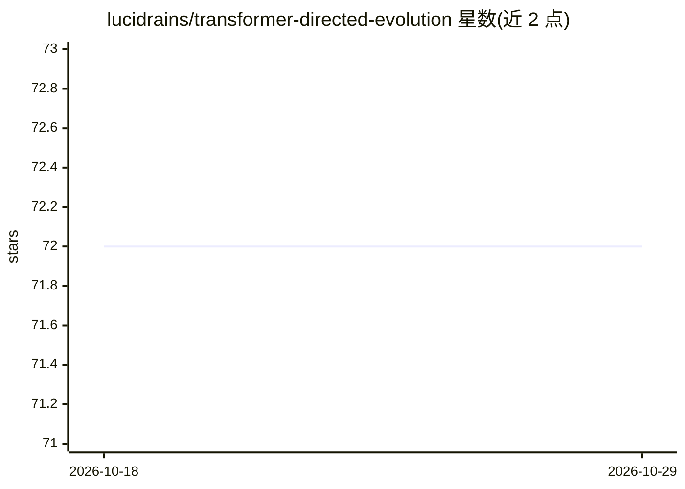

# lucidrains/transformer-directed-evolution

⭐ 72 · Python · MIT · 推送 2026-06-02 · [GitHub](https://github.com/lucidrains/transformer-directed-evolution) · 个人维护

**探索用 Transformer+RL 引导遗传算法加速收敛的研究代码**

lucidrains 的实验性研究仓库（wip），探索以 Transformer 结合强化学习来引导遗传算法的搜索方向，使其更快收敛。README 仅含项目说明与五篇相关文献的 BibTeX 引用（RL 辅助进化算法综述、Multi-critic Actor Learning、深度神经交叉算子、超基因基因组结构、拟南芥突变偏差），未给出安装、运行命令或 API 说明。以源码形式提供，面向关注进化算法与深度学习结合的研究者。

## 筛选速览

| 维度 | 判定 | 备注 |
|---|---|---|
| AI 角色 | `ai-native` | 本体是模型或模型工具 |
| 许可风险 | `permissive` | MIT |
| 部署形态 | `None` |  |
| 模型依赖 | — | README 未给出锁定关系 |
| 硬件要求 | — | 无带数字的原话,不猜 |
| 安装摩擦 | `low` | 无编译、无系统依赖或容器化 |
| 成熟度 | `idea` | |

## 能力要点

- 探索 Transformer+RL 引导遗传算法收敛的研究代码
- README 引用 RL 辅助进化算法等 5 篇相关文献
- 自标注为 wip（进行中）

## 适用场景

- 研究者参考进化算法与深度学习结合的实现思路
- 追踪 lucidrains 的实验性项目进展

## 场景标签

 · 领域:机器学习研究/进化算法

## 证据(README 行号)

> L1: ## Transformer RL Directed Evolution (wip)
> L3: Explorations into whether a transformer with RL can direct a genetic algorithm to converge faster

## 星数曲线

2026-10-18 72 → 2026-10-29 72（+0）

---
*卡片 v1 · prompt 1.4 · 生成 2026-10-24 · 置信度 mid · 依据 README sha `0ed7b0700ec6` · [字段定义](../../DATASET.md)*
