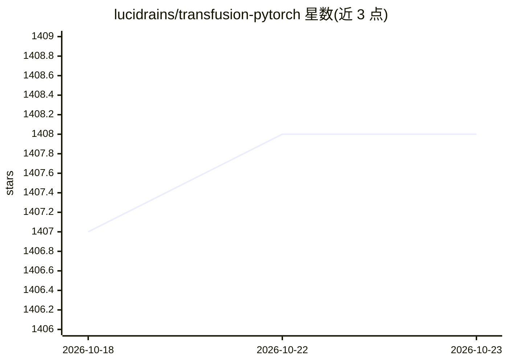

# lucidrains/transfusion-pytorch

⭐ 1,408 · Python · MIT · 推送 2026-09-04 · [GitHub](https://github.com/lucidrains/transfusion-pytorch) · 个人维护

**Transfusion 多模态模型（文本+图像/视频）的 PyTorch 实现**

PyTorch 实现的 Transfusion 论文（MetaAI，"Predict the Next Token and Diffuse Images with One Multi-Modal Model"），将扩散替换为 flow matching（参考 Flux 的做法），并扩展到任意数量模态。提供单模态与多模态训练/采样接口、图像编解码自动处理、sample_many 并行批量采样（文本共享 kv-cache 前向、模态共享 odeint 轨迹）、文本预训练、生成起始强制指定模态等功能。面向研究者与开发者，通过 pip 安装，支持 classifier free guidance。

## 筛选速览

| 维度 | 判定 | 备注 |
|---|---|---|
| AI 角色 | `ai-native` | 本体是模型或模型工具 |
| 许可风险 | `permissive` | MIT |
| 部署形态 | `library` | 以包/库形式分发 |
| 模型依赖 | — | README 未给出锁定关系 |
| 硬件要求 | — | 无带数字的原话,不猜 |
| 安装摩擦 | `low` | 无编译、无系统依赖或容器化 |
| 成熟度 | — | 结构信号不足 |

## 能力要点

- 用 flow matching 替换原论文的扩散过程，支持任意数量模态
- sample_many 并行批量采样：文本共享 kv-cache、模态共享 odeint 轨迹
- 自动处理图像编码与解码
- 可在生成起始强制指定模态类型与形状

## 适用场景

- 研究多模态（文本+图像/视频）统一建模
- 训练单模型同时生成文本与连续模态内容
- 先语言预训练再多模态训练的实验

## 场景标签

`多模态` `模型训练` · 领域:感知与多模态

## 证据(README 行号)

> L5: Pytorch implementation of Transfusion, "Predict the Next Token and Diffuse Images with One Multi-Modal Model", from 
> L7: In this repo, we will substitute diffusion with flow matching given the success of Flux from Black Forest Labs (but 

## 星数曲线

2026-10-18 1,407 → 2026-10-23 1,408（+1）

---
*卡片 v1 · prompt 1.4 · 生成 2026-10-21 · 置信度 high · 依据 README sha `1cd979009020` · [字段定义](../../DATASET.md)*
