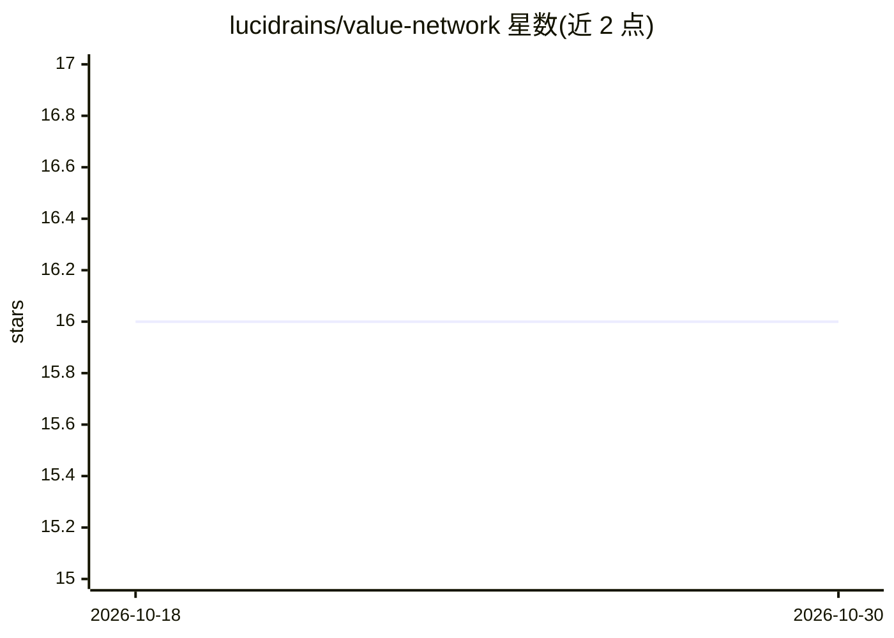

# lucidrains/value-network

⭐ 16 · Python · MIT · 推送 2026-02-10 · [GitHub](https://github.com/lucidrains/value-network) · 个人维护

**价值网络研究的探索性代码库（深度 RL 方向）**

lucidrains 维护的关于价值网络（value networks）新研究的探索性代码仓库，README 标注为 wip。可见内容仅包含三篇论文引用：Stop Regressing（用分类训练价值函数）、BaNEL（仅负奖励的生成式建模探索后验）、Vision Language Models are In-Context Value Learners（视觉语言模型作为上下文价值学习器）。README 未展示安装命令、使用方法或实现细节，内容以文献引用为主。

## 筛选速览

| 维度 | 判定 | 备注 |
|---|---|---|
| AI 角色 | `ai-native` | 本体是模型或模型工具 |
| 许可风险 | `permissive` | MIT |
| 部署形态 | `None` |  |
| 模型依赖 | — | README 未给出锁定关系 |
| 硬件要求 | — | 无带数字的原话,不猜 |
| 安装摩擦 | `low` | 无编译、无系统依赖或容器化 |
| 成熟度 | `idea` | |

## 能力要点

- 围绕价值网络新研究的探索性实现（wip 状态）
- README 引用三篇相关论文（分类训练价值函数、BaNEL、VLM 上下文价值学习）

## 适用场景

- 跟踪价值网络方向的实验性代码进展
- 作为相关研究论文的代码参考起点

## 场景标签

 · 领域:深度学习/强化学习研究

## 证据(README 行号)

> L1: ## Value network (wip)
> L3: Exploration into some new research surrounding value networks

## 星数曲线

2026-10-18 16 → 2026-10-30 16（+0）

---
*卡片 v1 · prompt 1.4 · 生成 2026-10-30 · 置信度 low · 依据 README sha `e16976a9075d` · [字段定义](../../DATASET.md)*
