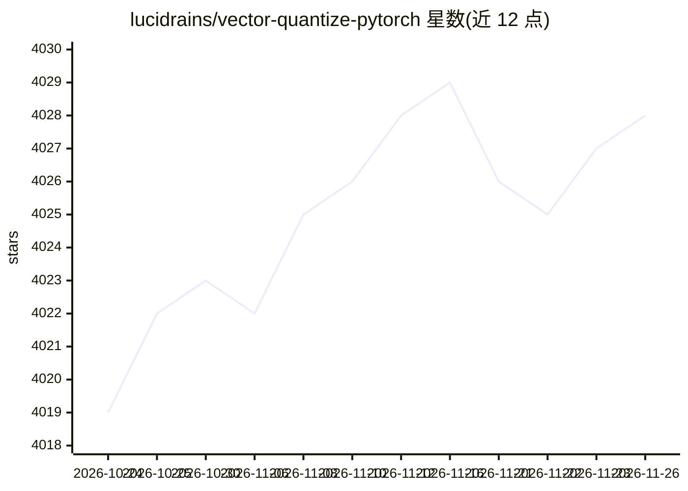

# lucidrains/vector-quantize-pytorch

⭐ 4,028 · Python · MIT · 推送 2026-11-17 · [GitHub](https://github.com/lucidrains/vector-quantize-pytorch) · 个人维护

**给 PyTorch 开发者提供多种向量/标量量化层的库**

源自 DeepMind TensorFlow 实现的向量量化 PyTorch 库，以 EMA 更新码本。支持 ResidualVQ、GroupedResidualVQ、FSQ、LFQ、SimVQ、FSP、RandomProjectionQuantizer 等多种量化方案，并集成 rotation trick、kmeans 初始化、死码过期、低维码本、cosine 相似度、正交正则等论文技巧，可用于图像/音频生成建模与语音建模场景。以 pip 包形式提供，用法为标准 PyTorch 模块调用。

## 筛选速览

| 维度 | 判定 | 备注 |
|---|---|---|
| AI 角色 | `ai-native` | 本体是模型或模型工具 |
| 许可风险 | `permissive` | MIT |
| 部署形态 | `library` | 以包/库形式分发 |
| 模型依赖 | — | README 未给出锁定关系 |
| 硬件要求 | — | 无带数字的原话,不猜 |
| 安装摩擦 | `low` | 无编译、无系统依赖或容器化 |
| 成熟度 | — | 结构信号不足 |

## 能力要点

- 提供 VectorQuantize/ResidualVQ/GroupedResidualVQ 等多种量化类
- 实现 FSQ、LFQ、SimVQ、FSP、RandomProjectionQuantizer 等论文方法
- 提供 kmeans 初始化、死码过期、rotation trick 等可开关选项
- 支持多进程下码本同步及多码本设置

## 适用场景

- 为 VQ-VAE/VQGAN 类图像生成模型构建离散 latent
- 音频编解码器训练中的残差量化
- masked speech 建模中使用随机投影量化器

## 场景标签

 · 领域:深度学习/模型组件库

## 证据(README 行号)

> L5: A vector quantization library originally transcribed from Deepmind's tensorflow implementation, made conveniently in
> L12: $ pip install vector-quantize-pytorch

## 星数曲线

2026-10-24 4,019 → 2026-11-26 4,028（+9）

---
*卡片 v1 · prompt 1.4 · 生成 2026-11-23 · 置信度 high · 依据 README sha `59be6c6bc645` · [字段定义](../../DATASET.md)*
