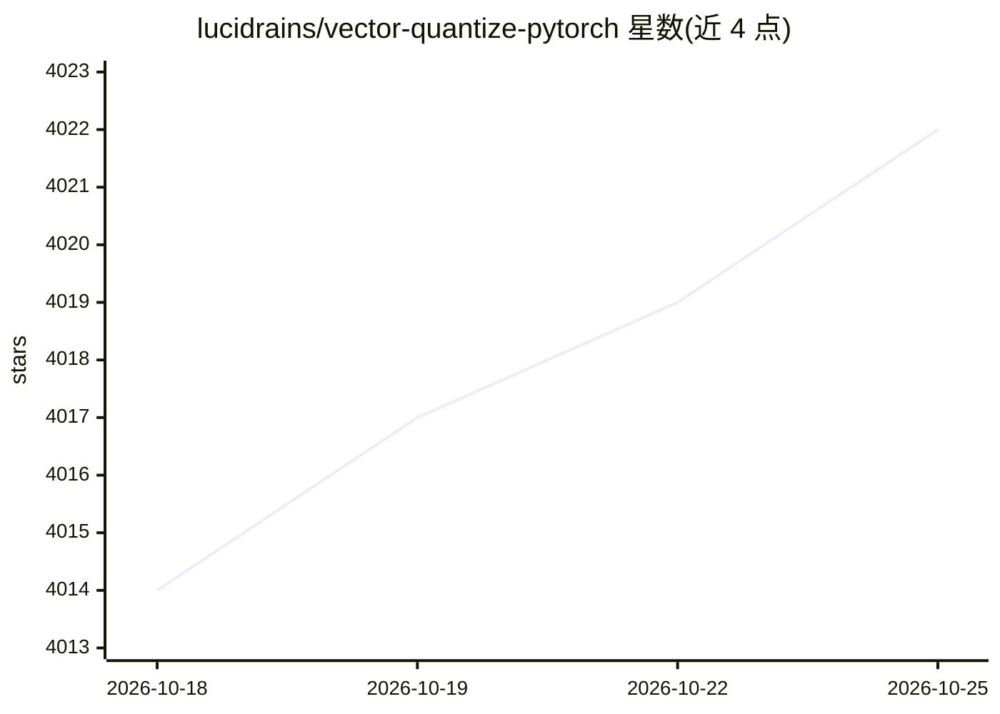

# lucidrains/vector-quantize-pytorch

⭐ 4,022 · Python · MIT · 推送 2026-10-24 · [GitHub](https://github.com/lucidrains/vector-quantize-pytorch) · 个人维护

**PyTorch 向量/标量量化库，供深度学习模型构建离散表示**

从 Deepmind 的 TensorFlow 实现转写而来的向量量化库，以 pip 包形式提供。核心类包括 VectorQuantize、ResidualVQ、GroupedResidualVQ、FSQ、LFQ、FSP、SimVQ、RandomProjectionQuantizer 等，覆盖多种论文提出的量化方案。默认使用指数移动平均更新码本，可选用 kmeans 初始化、旋转技巧梯度、DiVeQ 梯度更新；另提供缓解码本失效的技巧（余弦相似度、低维码本、过期码替换、正交正则等）。面向实现 VQ-VAE、音频/图像生成模型的深度学习开发者。

## 筛选速览

| 维度 | 判定 | 备注 |
|---|---|---|
| AI 角色 | `ai-native` | 本体是模型或模型工具 |
| 许可风险 | `permissive` | MIT |
| 部署形态 | `library` | 以包/库形式分发 |
| 模型依赖 | — | README 未给出锁定关系 |
| 硬件要求 | — | 无带数字的原话,不猜 |
| 安装摩擦 | `low` | 无编译、无系统依赖或容器化 |
| 成熟度 | — | 结构信号不足 |

## 能力要点

- VectorQuantize / ResidualVQ / GroupedResidualVQ 等多种量化类
- EMA 码本更新、kmeans 初始化、旋转技巧与 DiVeQ 梯度选项
- 包含 FSQ / LFQ / SimVQ / FSP / RandomProjectionQuantizer 等论文方案实现
- 提供低维码本、余弦相似度、过期码替换等缓解死码的技巧

## 适用场景

- 实现 VQ-VAE / RQ-VAE 等图像与音频生成模型
- 为自回归模型构建离散 token 表示
- 音频压缩与掩码语音建模中的残差量化

## 场景标签

 · 领域:深度学习/生成模型组件

## 证据(README 行号)

> L5: A vector quantization library originally transcribed from Deepmind's tensorflow implementation, made conveniently in
> L24: ## Residual VQ

## 星数曲线

2026-10-18 4,014 → 2026-10-25 4,022（+8）

---
*卡片 v1 · prompt 1.4 · 生成 2026-10-20 · 置信度 high · 依据 README sha `ae158719b704` · [字段定义](../../DATASET.md)*
