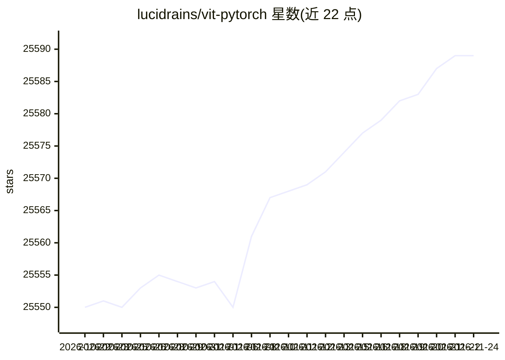

# lucidrains/vit-pytorch

⭐ 25,589 · Python · MIT · 推送 2026-11-07 · [GitHub](https://github.com/lucidrains/vit-pytorch) · 个人维护

**研究者的 PyTorch 版 Vision Transformer 实现合集**

以 PyTorch 包形式提供 Vision Transformer 及数十种后续变体（SimpleViT、NaViT、可蒸馏 ViT、DeepViT、CaiT、CCT、CrossViT、MaxViT、MobileViT、XCiT 等）的模型实现，每个变体对应一篇论文并给出参数说明与使用示例。面向需要图像分类模型实现的研究与开发人员，通过 pip 安装后导入类即可构建模型。README 未包含训练脚本、预训练权重或数据处理流程。

## 筛选速览

| 维度 | 判定 | 备注 |
|---|---|---|
| AI 角色 | `ai-native` | 本体是模型或模型工具 |
| 许可风险 | `permissive` | MIT |
| 部署形态 | `library` | 以包/库形式分发 |
| 模型依赖 | — | README 未给出锁定关系 |
| 硬件要求 | — | 无带数字的原话,不猜 |
| 安装摩擦 | `low` | 无编译、无系统依赖或容器化 |
| 成熟度 | — | 结构信号不足 |

## 动量与使用信号

- 维护:`active` — 距上次 push 4.8 天,年发版 24,28 位贡献者
- 涨星:近 1 天 **+3**(自 20261016 起算)
- 安装:pypi 包 `vit-pytorch` 月下载 910,233

## 能力要点

- 提供原始 ViT 及数十种论文变体的 PyTorch 模型实现
- 支持从卷积网络（如 ResNet50）向 ViT 蒸馏的 DistillableViT
- NaViT 支持多分辨率图像打包训练与嵌套张量路径
- pip 一键安装，各变体独立子模块导入

## 适用场景

- 搭建图像分类模型做视觉 Transformer 实验复现
- 将卷积教师网络的知识蒸馏到小型 ViT
- 尝试多分辨率训练的 NaViT 变体

## 场景标签

 · 领域:计算机视觉/深度学习模型实现

## 证据(README 行号)

> L7: Implementation of Vision Transformer, a simple way to achieve SOTA in vision classification with only a single trans
> L20: $ pip install vit-pytorch

## 星数曲线

2026-10-22 25,550 → 2026-11-24 25,589（+39）

---
*卡片 v1 · prompt 1.4 · 生成 2026-11-22 · 置信度 high · 依据 README sha `2f50f20190eb` · [字段定义](../../DATASET.md)*
