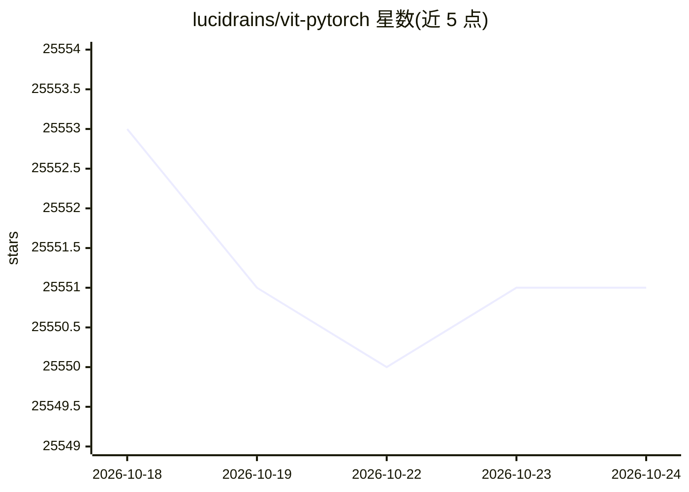

# lucidrains/vit-pytorch

⭐ 25,551 · Python · MIT · 推送 2026-10-13 · [GitHub](https://github.com/lucidrains/vit-pytorch) · 个人维护

**为研究者提供 PyTorch 版 Vision Transformer 及多种变体实现**

以 PyTorch 库形式实现的 Vision Transformer（ViT）图像分类模型，通过 pip 安装后在 Python 中以 `from vit_pytorch import ViT` 方式使用。核心是单一 transformer encoder 结构，参数覆盖 image_size、patch_size、depth、heads、mlp_dim、dropout 等。除基础 ViT 外，还收录 Simple ViT、NaViT、DistillableViT、Deep ViT、CaiT、CCT、Cross ViT、MaxViT、MobileViT 等数十种论文变体的实现，各变体以独立子模块导入，附对应用法代码示例。

## 筛选速览

| 维度 | 判定 | 备注 |
|---|---|---|
| AI 角色 | `ai-enhanced` | 去掉 AI 部分产品仍成立 |
| 许可风险 | `permissive` | MIT |
| 部署形态 | `library` | 以包/库形式分发 |
| 模型依赖 | — | README 未给出锁定关系 |
| 硬件要求 | — | 无带数字的原话,不猜 |
| 安装摩擦 | `low` | 无编译、无系统依赖或容器化 |
| 成熟度 | — | 结构信号不足 |

## 动量与使用信号

- 维护:`active` — 距上次 push 4.8 天,年发版 24,28 位贡献者
- 涨星:近 1 天 **+3**(自 20261016 起算)
- 安装:pypi 包 `vit-pytorch` 月下载 910,233

## 能力要点

- 提供基础 ViT 实现及 image_size/patch_size/depth/heads 等参数配置
- 收录数十种 ViT 论文变体：Simple ViT、NaViT、CaiT、CCT、CrossViT、MaxViT、MobileViT 等
- 支持从卷积网络（如 Resnet50）到 ViT 的蒸馏训练（DistillableViT，可 `.to_vit` 转回 ViT）
- pip 一条命令安装，各变体独立子模块导入

## 适用场景

- 在 PyTorch 中搭建图像分类的 Vision Transformer 模型
- 复现或试验不同 ViT 论文变体架构
- 从 CNN 教师模型蒸馏出小型视觉 Transformer

## 场景标签

 · 领域:计算机视觉/深度学习模型实现

## 证据(README 行号)

> L7: Implementation of Vision Transformer, a simple way to achieve SOTA in vision classification with only a single trans
> L20: $ pip install vit-pytorch
> L27: from vit_pytorch import ViT

## 星数曲线

2026-10-18 25,553 → 2026-10-24 25,551（-2）

---
*卡片 v1 · prompt 1.4 · 生成 2026-10-18 · 置信度 high · 依据 README sha `ac7340901dbc` · [字段定义](../../DATASET.md)*
