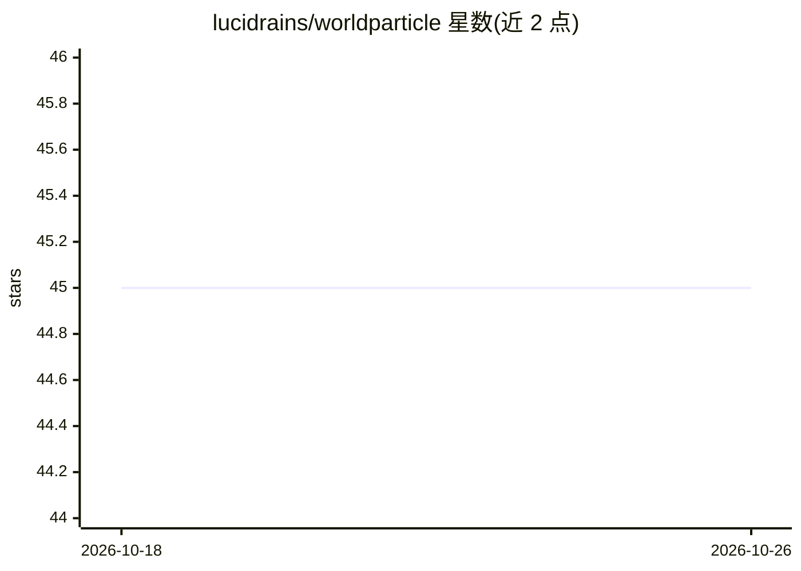

# lucidrains/worldparticle

⭐ 45 · Python · MIT · 推送 2026-08-11 · [GitHub](https://github.com/lucidrains/worldparticle) · 个人维护

**WorldParticle 论文的 PyTorch 实现：Transformer 模拟拉格朗日粒子动力学**

lucidrains 维护的 WorldParticle 官方描述中论文实现：用 Transformer 统一模拟拉格朗日粒子动力学，面向深度学习研究者。提供 pip 安装的 Python 库，使用时导入 torch 与 WorldParticle、ParticleTokenizer 模块构建粒子 tokenizer 并运行仿真。README 附两篇 bibtex 引用（WorldParticle 原论文与 Next-Latent Prediction Transformers），无硬件要求或部署细节说明。

## 筛选速览

| 维度 | 判定 | 备注 |
|---|---|---|
| AI 角色 | `ai-native` | 本体是模型或模型工具 |
| 许可风险 | `permissive` | MIT |
| 部署形态 | `library` | 以包/库形式分发 |
| 模型依赖 | — | README 未给出锁定关系 |
| 硬件要求 | — | 无带数字的原话,不猜 |
| 安装摩擦 | `low` | 无编译、无系统依赖或容器化 |
| 成熟度 | — | 结构信号不足 |

## 能力要点

- 基于 Transformer 的拉格朗日粒子动力学统一模拟
- 提供 ParticleTokenizer 粒子分词模块
- pip 可安装的 Python 库

## 适用场景

- 复现 WorldParticle 论文的粒子动力学仿真
- 在研究项目中用 Transformer 建模粒子系统
- 作为拉格朗日粒子模拟的学习参考实现

## 场景标签

`科研工具` · 领域:学习与行业

## 证据(README 行号)

> L5: Implementation of WorldParticle, Unified Simulation of Lagrangian Particle Dynamics via Transformer
> L15: ```python

## 星数曲线



2026-10-18 45 → 2026-10-26 45（+0）


---
*卡片 v1 · prompt 1.4 · 生成 2026-10-25 · 置信度 high · 依据 README sha `1bbf6686775d` · [字段定义](../../DATASET.md)*
