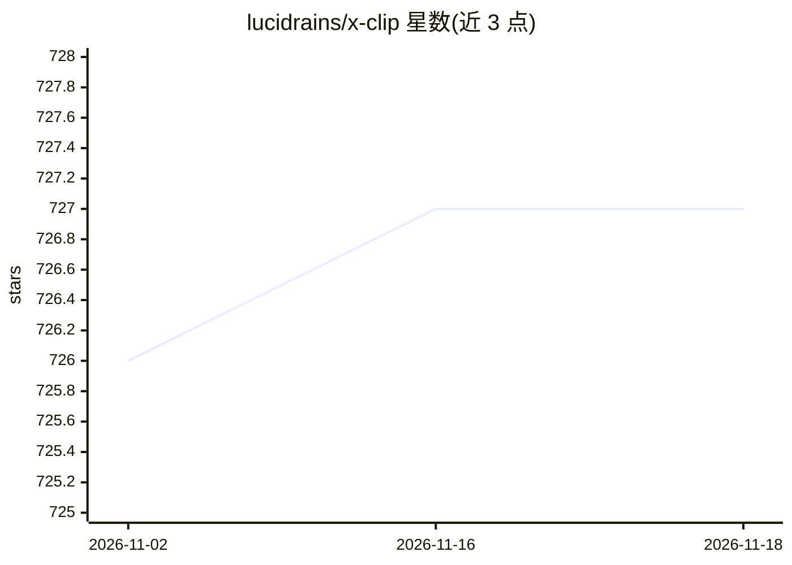

# lucidrains/x-clip

⭐ 727 · Python · MIT · 推送 2026-11-03 · [GitHub](https://github.com/lucidrains/x-clip) · 个人维护

**PyTorch 实现的 CLIP 库，含多篇论文的对比学习改进**

lucidrains 维护的多模态对比学习库：提供 CLIP 的 PyTorch 实现，支持接入外部图像编码器与文本编码器（需返回指定形状的嵌入）、DeCLIP 提出的多视图对比损失，以及多种可选附加损失项（相似度统计正则、谱对比损失、非对称 InfoNCE 等，默认关闭）。支持通过 visual_ssl 关键字传入自定义视觉自监督模块（如 SimSiam）。面向深度学习研究者与开发者，以 pip 包形式分发。

## 筛选速览

| 维度 | 判定 | 备注 |
|---|---|---|
| AI 角色 | `ai-native` | 本体是模型或模型工具 |
| 许可风险 | `permissive` | MIT |
| 部署形态 | `library` | 以包/库形式分发 |
| 模型依赖 | — | README 未给出锁定关系 |
| 硬件要求 | — | 无带数字的原话,不猜 |
| 安装摩擦 | `low` | 无编译、无系统依赖或容器化 |
| 成熟度 | — | 结构信号不足 |

## 能力要点

- CLIP 的 PyTorch 实现，含近年论文的实验性改进
- 可接入外部图像/文本编码器
- 支持 DeCLIP 式多视图对比学习损失
- 6 种可选附加损失项（默认关闭）

## 适用场景

- 在自有数据上训练 CLIP 风格的图文对比模型
- 复现或试验论文中的对比学习改进（DeCLIP、谱对比损失等）
- 搭配 vit_pytorch 等外部编码器构建多模态模型

## 场景标签

`多模态` · 领域:感知与多模态

## 证据(README 行号)

> L7: A concise but complete implementation of CLIP with various experimental improvements from recent papers
> L46: ## Multiview CL Losses

## 星数曲线

2026-11-02 726 → 2026-11-18 727（+1）

---
*卡片 v1 · prompt 1.4 · 生成 2026-11-17 · 置信度 high · 依据 README sha `ff613233c8fc` · [字段定义](../../DATASET.md)*
