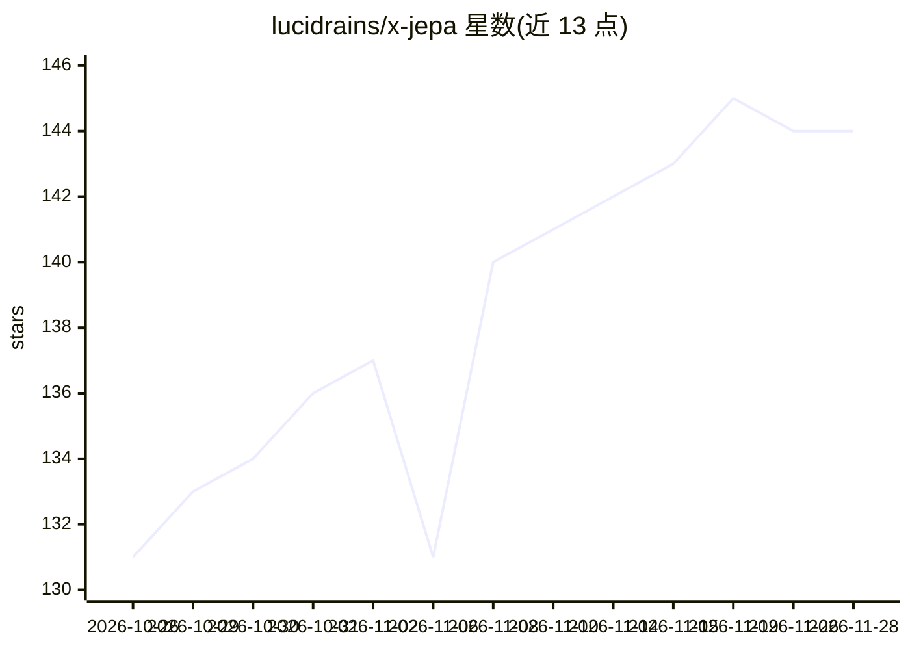

# lucidrains/x-jepa

⭐ 144 · Python · MIT · 推送 2026-11-23 · [GitHub](https://github.com/lucidrains/x-jepa) · 个人维护

**对 LeCun 倡导的 JEPA 架构路线的研究性实现仓库（wip）**

标为 wip 的探索性项目，围绕 Yann LeCun 提出的联合嵌入预测架构（JEPA）与世界模型路线进行实现探索。当前 README 内容以引用文献为主，列出 20 余篇相关论文的 BibTeX，涵盖 LeWorldModel、LeJEPA、视觉-语言预训练、世界模型规划与强化学习探索等方向，暂未展示安装方式或使用示例。

## 筛选速览

| 维度 | 判定 | 备注 |
|---|---|---|
| AI 角色 | `ai-native` | 本体是模型或模型工具 |
| 许可风险 | `permissive` | MIT |
| 部署形态 | `None` |  |
| 模型依赖 | — | README 未给出锁定关系 |
| 硬件要求 | — | 无带数字的原话,不猜 |
| 安装摩擦 | `low` | 无编译、无系统依赖或容器化 |
| 成熟度 | `idea` | |

## 能力要点

- 探索 JEPA（联合嵌入预测架构）与世界模型路线的实现
- 收录 LeCun《A Path Towards Autonomous Machine Intelligence》等 20 余篇相关文献引用
- 涉及自监督学习、潜在空间规划、强化学习探索等关联研究方向

## 适用场景

- 研究 JEPA / 世界模型架构的实现细节
- 查阅该路线相关论文的引文线索

## 场景标签

 · 领域:深度学习研究

## 证据(README 行号)

> L3: ## x-jepa (wip)
> L5: Explorations into some of the approaches advocated by Yann LeCun, and just a more wholistic architecture (JEPA) in g

## 星数曲线

2026-10-26 131 → 2026-11-28 144（+13）

---
*卡片 v1 · prompt 1.4 · 生成 2026-11-27 · 置信度 mid · 依据 README sha `75ae9939f020` · [字段定义](../../DATASET.md)*
