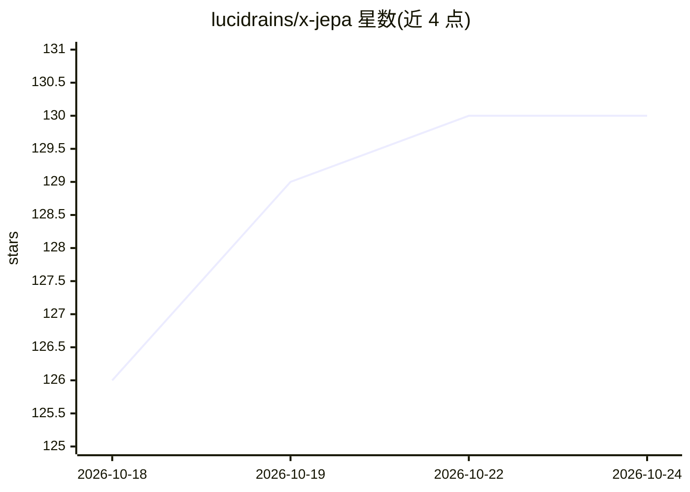

# lucidrains/x-jepa

⭐ 130 · Python · MIT · 推送 2026-09-21 · [GitHub](https://github.com/lucidrains/x-jepa) · 个人维护

**JEPA 类自监督世界模型架构的探索性代码库**

lucidrains 维护的探索性研究仓库，围绕 Yann LeCun 提倡的 JEPA（联合嵌入预测架构）及相关世界模型方法进行实现与实验。README 标注 wip（进行中），正文仅列出所依据的论文引用（LeJEPA、LeWorldModel、JEPA-Anything 等二十余篇），未给出安装命令、运行方式或功能说明，代码结构需直接查看仓库源码确认。面向关注自监督学习与世界模型的深度学习研究者。

## 筛选速览

| 维度 | 判定 | 备注 |
|---|---|---|
| AI 角色 | `ai-native` | 本体是模型或模型工具 |
| 许可风险 | `permissive` | MIT |
| 部署形态 | `None` |  |
| 模型依赖 | — | README 未给出锁定关系 |
| 硬件要求 | — | 无带数字的原话,不猜 |
| 安装摩擦 | `low` | 无编译、无系统依赖或容器化 |
| 成熟度 | `idea` | |

## 能力要点

- 围绕 JEPA 与世界模型方法的实现探索
- README 引用 LeJEPA、LeWorldModel、JEPA-Anything 等系列论文
- 自标注 wip，处于进行中状态

## 适用场景

- 研究 JEPA 类架构的实现细节
- 复现或扩展 LeCun 路线的自监督世界模型实验

## 场景标签

`模型训练` · 领域:训练与推理

## 证据(README 行号)

> L3: ## x-jepa (wip)
> L5: Explorations into some of the approaches advocated by Yann LeCun, and just a more wholistic architecture (JEPA) in g

## 星数曲线

2026-10-18 126 → 2026-10-24 130（+4）

---
*卡片 v1 · prompt 1.4 · 生成 2026-10-22 · 置信度 mid · 依据 README sha `012313a50015` · [字段定义](../../DATASET.md)*
