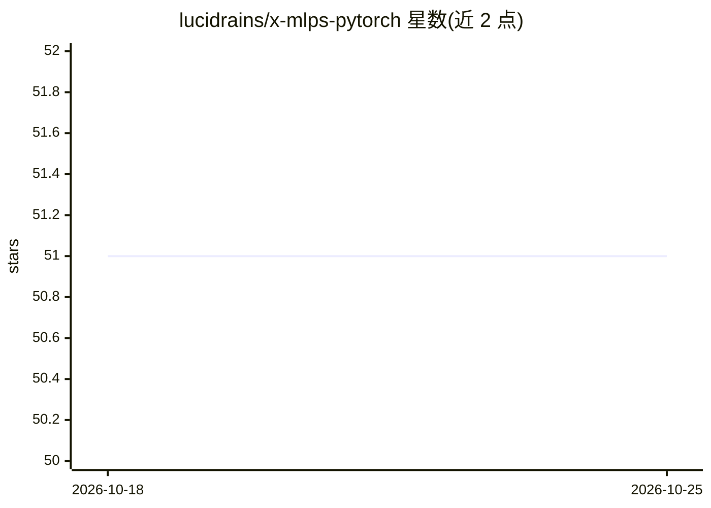

# lucidrains/x-mlps-pytorch

⭐ 51 · Python · MIT · 推送 2026-10-15 · [GitHub](https://github.com/lucidrains/x-mlps-pytorch) · 个人维护

**PyTorch 的 MLP 及变体组件库，避免跨项目重复实现**

lucidrains 维护的 PyTorch 多层感知机（MLP）组件集合，收录从常规到研究论文中提出的多种 MLP 变体（如 Primer 的 SquaredReLU、ReLU²、Hyperspherical Normalization、Post-LayerNorm 等），供在不同项目（尤其强化学习）中复用，避免重复实现。以 Python 包形式通过 pip 安装，使用方式为从 x_mlps_pytorch 导入 MLP 类并配置维度等参数构建网络层。README 各变体均附对应论文的 BibTeX 引用。

## 筛选速览

| 维度 | 判定 | 备注 |
|---|---|---|
| AI 角色 | `ai-ecosystem` | LLM/agent 周边工具 |
| 许可风险 | `permissive` | MIT |
| 部署形态 | `library` | 以包/库形式分发 |
| 模型依赖 | — | README 未给出锁定关系 |
| 硬件要求 | — | 无带数字的原话,不猜 |
| 安装摩擦 | `low` | 无编译、无系统依赖或容器化 |
| 成熟度 | — | 结构信号不足 |

## 能力要点

- 收录常规及多篇论文提出的 MLP 变体实现
- 面向跨项目复用，特别提及 RL 场景
- 每个变体附原始论文引用

## 适用场景

- 在 PyTorch 项目中直接复用各类 MLP 变体
- RL 实验中快速更换网络结构与激活函数
- 对照论文实现复现 MLP 相关模块

## 场景标签

 · 领域:深度学习/神经网络组件

## 证据(README 行号)

> L3: Just a repository that will house MLPs for Pytorch, from garden variety to the exotic, so as to avoid having to reim
> L14: import torch

## 星数曲线

2026-10-18 51 → 2026-10-25 51（+0）

---
*卡片 v1 · prompt 1.4 · 生成 2026-10-24 · 置信度 high · 依据 README sha `ed9ea07ea1e4` · [字段定义](../../DATASET.md)*
