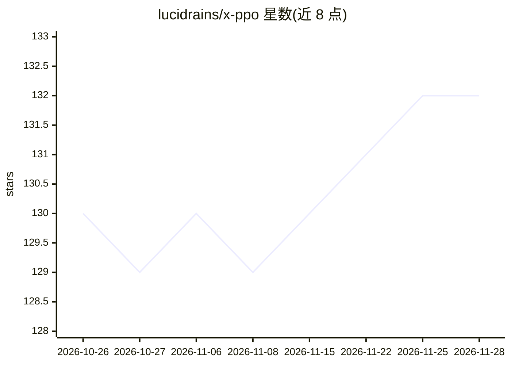

# lucidrains/x-ppo

⭐ 132 · Python · MIT · 推送 2026-11-24 · [GitHub](https://github.com/lucidrains/x-ppo) · 个人维护

**研究者的 PyTorch PPO 强化学习算法实现库**

以 PyTorch 实现的近端策略优化（PPO）库，汇集多篇近期论文的改进：PPO/SPO/HPO actor 损失、序列级 GSPO 损失、clipped value critic、广义优势估计（含有限时间修正与 Semi-Markov GAE）、多 critic 分组优势组合，以及无需环境的 DAgger 蒸馏模块。提供训练示例脚本与 gymnasium 环境对接；作者声明移除了 phasic 部分。面向 RL 研究与实验用户。

## 筛选速览

| 维度 | 判定 | 备注 |
|---|---|---|
| AI 角色 | `ai-native` | 本体是模型或模型工具 |
| 许可风险 | `permissive` | MIT |
| 部署形态 | `library` | 以包/库形式分发 |
| 模型依赖 | — | README 未给出锁定关系 |
| 硬件要求 | — | 无带数字的原话,不猜 |
| 安装摩擦 | `low` | 无编译、无系统依赖或容器化 |
| 成熟度 | — | 结构信号不足 |

## 能力要点

- 提供 ppo/spo/hpo 三种 actor 损失及序列级 GSPO 损失
- calc_gae 支持有限时间修正、Semi-Markov GAE 与 gymnasium 信号
- 多 critic：按奖励组归一化优势再组合
- DaggerDistiller 支持任意 teacher→student 蒸馏与复合动作空间

## 适用场景

- 在 gymnasium 环境中训练策略梯度强化学习智能体
- 对 PPO 类算法的不同改进做对照实验
- 把已有 teacher 策略蒸馏到任意结构的 student 网络

## 场景标签

`强化学习` · 领域:训练与推理

## 证据(README 行号)

> L7: An implementation of PPO with recent random improvements
> L31: $ python train.py

## 星数曲线

2026-10-26 130 → 2026-11-28 132（+2）

---
*卡片 v1 · prompt 1.4 · 生成 2026-11-28 · 置信度 high · 依据 README sha `eac8b2556f90` · [字段定义](../../DATASET.md)*
