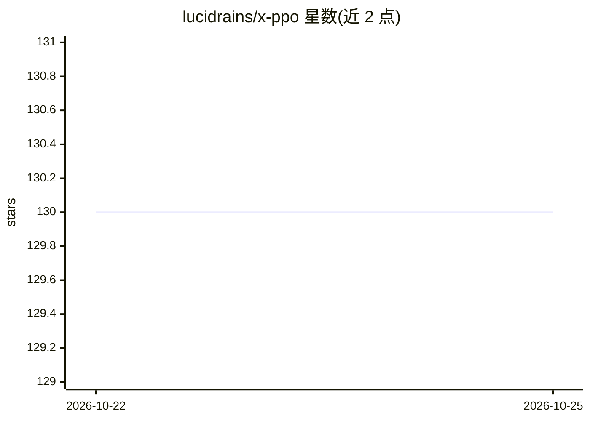

# lucidrains/x-ppo

⭐ 130 · Python · MIT · 推送 2026-10-24 · [GitHub](https://github.com/lucidrains/x-ppo) · 个人维护

**PyTorch 的 PPO 强化学习算法实现库，供 RL 研究与训练使用**

lucidrains 维护的 PyTorch 版 PPO（近端策略优化）实现，包含 clipped surrogate actor loss、clipped value critic loss、GAE 优势估计、多 critic 优势分组归一与组合，以及 SPO actor loss、improved value clipping 等可替换损失。另提供 DAgger 蒸馏模块 DaggerDistiller，可把任意教师模型蒸馏到学生模型，支持复合动作空间与表征对齐。训练入口为 train.py，各组件均以 Python 函数形式导入使用，README 附大量论文引用。

## 筛选速览

| 维度 | 判定 | 备注 |
|---|---|---|
| AI 角色 | `ai-native` | 本体是模型或模型工具 |
| 许可风险 | `permissive` | MIT |
| 部署形态 | `library` | 以包/库形式分发 |
| 模型依赖 | — | README 未给出锁定关系 |
| 硬件要求 | — | 无带数字的原话,不猜 |
| 安装摩擦 | `low` | 无编译、无系统依赖或容器化 |
| 成熟度 | — | 结构信号不足 |

## 能力要点

- PPO actor/critic 损失与 GAE 的 PyTorch 模块化实现
- 多 critic 结构：按奖励组独立归一化优势后再组合
- spo_actor_loss / improved_value_clipping_fn 等可替换损失
- DaggerDistiller：任意教师到学生的 DAgger 蒸馏，无需环境

## 适用场景

- 在 PyTorch 项目中直接调用 PPO 损失函数训练 RL 策略
- 多奖励组的策略训练与优势组合
- 将教师策略蒸馏到学生模型（DAgger 循环）

## 场景标签

`强化学习` · 领域:训练与推理

## 证据(README 行号)

> L7: An implementation of PPO with recent random improvements
> L33: Clipped surrogate - Schulman et al.

## 星数曲线

2026-10-22 130 → 2026-10-25 130（+0）

---
*卡片 v1 · prompt 1.4 · 生成 2026-10-22 · 置信度 high · 依据 README sha `1d6f81c9027e` · [字段定义](../../DATASET.md)*
