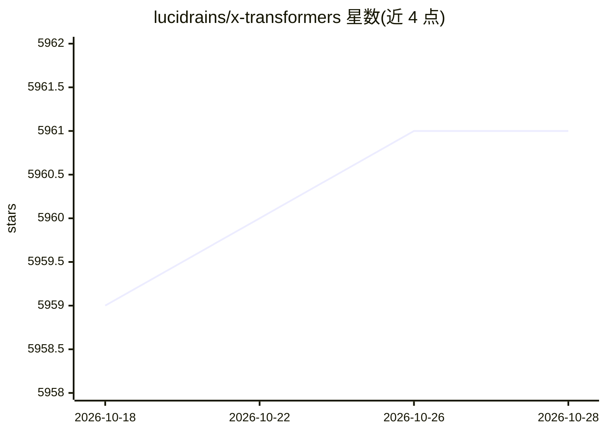

# lucidrains/x-transformers

⭐ 5,961 · Python · MIT · 推送 2026-10-23 · [GitHub](https://github.com/lucidrains/x-transformers) · 个人维护

**为研究者提供的全功能 PyTorch transformer 实验库**

lucidrains 维护的 PyTorch transformer 组件库：提供 encoder-only（BERT 式）、decoder-only（GPT 式）、encoder/decoder（PaLI 式）与视觉（ViT 式）等完整搭建方式，并从数十篇论文移植可选实验特性，如 Flash Attention、persistent memory、RMSNorm、GLU 变体、sparse attention、talking-heads、weight-tied layers 等。面向想快速复现或试验最新 transformer 架构改进的深度学习研究者与开发者，通过 pip 安装，每个特性以开关参数形式启用，README 附论文 arXiv 链接与用法示例。

## 筛选速览

| 维度 | 判定 | 备注 |
|---|---|---|
| AI 角色 | `ai-native` | 本体是模型或模型工具 |
| 许可风险 | `permissive` | MIT |
| 部署形态 | `library` | 以包/库形式分发 |
| 模型依赖 | — | README 未给出锁定关系 |
| 硬件要求 | — | 无带数字的原话,不猜 |
| 安装摩擦 | `medium` | 含编译或系统依赖之一 |
| 成熟度 | — | 结构信号不足 |

## 能力要点

- 支持 encoder/decoder、decoder-only、encoder-only 及视觉与图文多模态搭建
- 集成数十篇论文的实验特性（Flash Attention、RMSNorm、GLU、sparse attention 等）
- 每个特性提供开关参数与 arXiv 论文出处
- pip install x-transformers 即装即用

## 适用场景

- 快速搭建 GPT/BERT/ViT 式模型进行实验
- 复现或对比最新 transformer 架构改进论文
- 为自研模型试验 attention 变体与归一化方案

## 场景标签

 · 领域:深度学习/模型架构

## 证据(README 行号)

> L5: A concise but fully-featured transformer, complete with a set of promising e**x**perimental features from various pa
> L15: Full encoder / decoder

## 星数曲线

2026-10-18 5,959 → 2026-10-28 5,961（+2）

---
*卡片 v1 · prompt 1.4 · 生成 2026-10-20 · 置信度 high · 依据 README sha `b4bec57ecb8c` · [字段定义](../../DATASET.md)*
