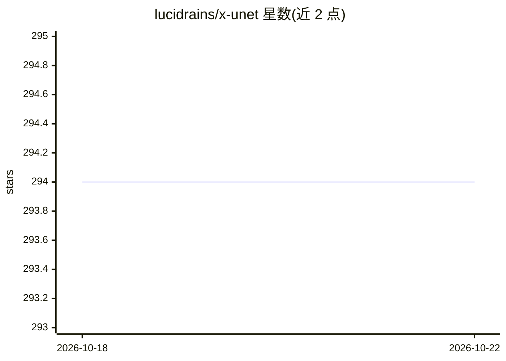

# lucidrains/x-unet

⭐ 294 · Python · MIT · 推送 2026-09-23 · [GitHub](https://github.com/lucidrains/x-unet) · 个人维护

**U-Net 架构 PyTorch 实现库，供图像分割与生成任务开发**

以 PyTorch 实现 U-Net 架构，集成高效注意力与多项研究进展（query-key 归一化、权重标准化、ConvNeXt V2 等）；支持 2D 与 3D 输入（视频或 CT/MRI 扫描），可用 XAttnRes 学习式跨阶段注意力残差替换预定义跳跃连接，XAttnRes 亦可单独作为多尺度特征路由器使用。面向构建图像分割/生成模型的开发者与科研人员，以 pip 包与代码示例形式提供。Todo 中列出 3D 内存效率优化尚未实现。

## 筛选速览

| 维度 | 判定 | 备注 |
|---|---|---|
| AI 角色 | `ai-native` | 本体是模型或模型工具 |
| 许可风险 | `permissive` | MIT |
| 部署形态 | `library` | 以包/库形式分发 |
| 模型依赖 | — | README 未给出锁定关系 |
| 硬件要求 | — | 无带数字的原话,不猜 |
| 安装摩擦 | `low` | 无编译、无系统依赖或容器化 |
| 成熟度 | — | 结构信号不足 |

## 能力要点

- 支持 2D 与 3D（视频/CT/MRI）输入的 U-Net 实现
- XAttnRes 学习式跨阶段注意力残差可替换预定义跳跃连接
- 集成 query-key 归一化、权重标准化、ConvNeXt V2 等研究进展

## 适用场景

- 构建医学影像或通用图像分割模型
- 为图像生成任务嵌入 U-Net 主干
- 用 XAttnRes 做多尺度特征路由实验

## 场景标签

`图像生成` `目标检测` · 领域:内容生成

## 证据(README 行号)

> L5: Implementation of a U-net complete with efficient attention as well as the latest research findings
> L31: For 3d (video or CT / MRI scans)

## 星数曲线

2026-10-18 294 → 2026-10-22 294（+0）

---
*卡片 v1 · prompt 1.4 · 生成 2026-10-21 · 置信度 high · 依据 README sha `0e0d07267f99` · [字段定义](../../DATASET.md)*
