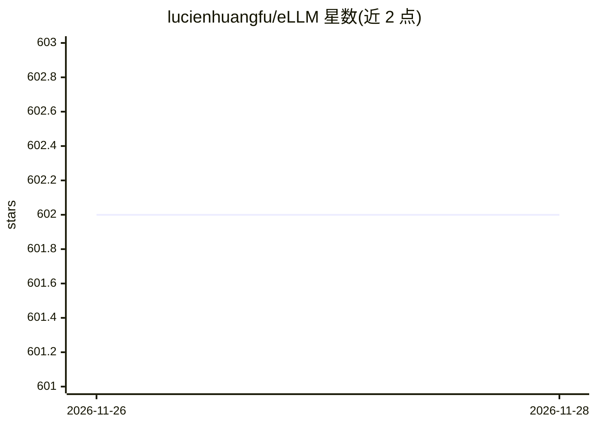

# lucienhuangfu/eLLM

⭐ 602 · Rust · AGPL-3.0 · 推送 2026-11-26 · [GitHub](https://github.com/lucienhuangfu/eLLM) · 个人维护 · 中文 README

**让 CPU 服务器跑长程 Agent 推理的 LLM 框架**

面向 CPU 服务器的 LLM 推理框架，采用"以存储换计算"策略，利用大容量 DDR 内存弥补与 GPU HBM 的带宽差距。机制上通过弹性静态计算图、非分页定形 KV cache、会话缓存实现多轮增量 Prefill，免除历史上下文重算。纯 CPU 推理，要求 AVX-512 FP16 与 128GB+ 内存；兼容 vLLM API。当前仅支持 Qwen3 系列，从源码构建，处于活跃开发阶段，附论文与基准对比。

## 筛选速览

| 维度 | 判定 | 备注 |
|---|---|---|
| AI 角色 | `ai-ecosystem` | LLM/agent 周边工具 |
| 许可风险 | `viral` | AGPL-3.0 |
| 部署形态 | `None` |  |
| 模型依赖 | local-ok | 支持本地模型 |
| 硬件要求 | — | 无带数字的原话,不猜 |
| 安装摩擦 | `low` | 无编译、无系统依赖或容器化 |
| 成熟度 | `idea` | |

## 能力要点

- 纯 CPU 推理，无需 GPU/NPU
- vLLM API 兼容，接入现有生态
- Session Cache 跨多轮保留 KV，仅对新输入增量 Prefill
- 支持 TB 级内存下的百万 token 上下文

## 适用场景

- 为多步骤长执行的 Agent 工作流提供低延迟推理
- 跨文件大型代码仓库的代码 Agent 后端
- 企业知识库问答与长文档分析
- 持续多轮检索综合的 Deep Research 任务

## 场景标签

`推理引擎` · 领域:训练与推理

## 证据(README 行号)

> L2: eLLM is an LLM inference framework for CPU servers. It adopts a "trade storage for computation" strategy, leveraging
> L20: **eLLM**: an LLM inference framework for CPU servers
> L24: - vLLM API compatible, plugs directly into the existing ecosystem

## 星数曲线

2026-11-26 602 → 2026-11-28 602（+0）

---
*卡片 v1 · prompt 1.4 · 生成 2026-11-26 · 置信度 high · 依据 README sha `1d814df2c9f7` · [字段定义](../../DATASET.md)*
