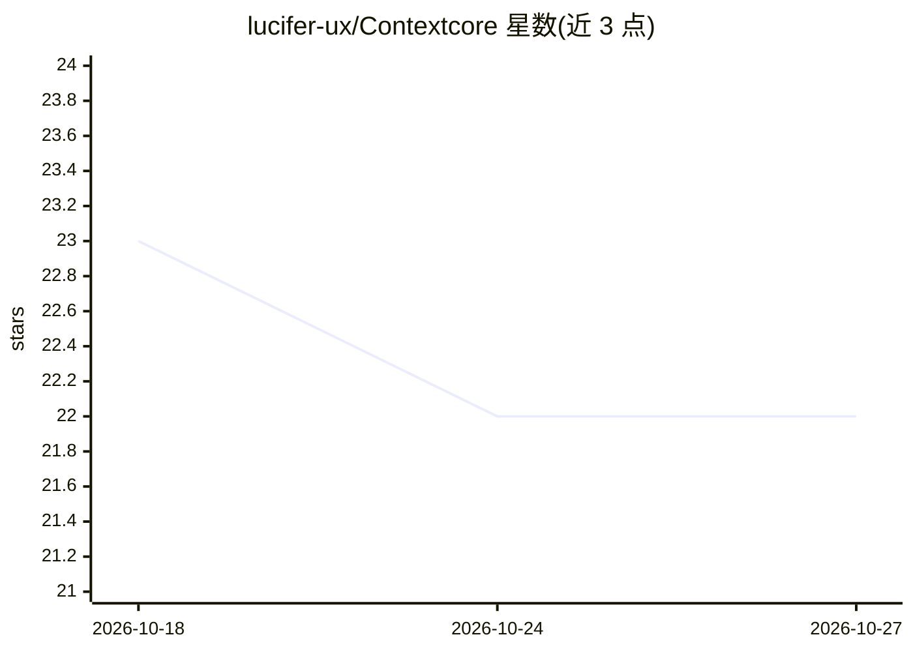

# lucifer-ux/Contextcore

⭐ 22 · Python · AGPL-3.0 · 推送 2026-07-22 · [GitHub](https://github.com/lucifer-ux/Contextcore) · [官网](https://4bits.co/documentation) · 个人维护

**本地文件混合检索 MCP 服务器，为 AI 工具按需注入检索片段**

面向使用 Claude Desktop、Claude Code、Cursor、Cline 等 MCP 兼容工具的开发者的本地 MCP 服务器：在本地索引文本、代码、图片、音频、视频文件，通过 BM25+嵌入的混合检索，让 AI 工具以 search 工具调用方式只取相关片段注入上下文，而非粘贴整文件。README 给出 SciFact 上 token 减少 57.45% 的基准数据。默认本地存储（SQLite），可选 Turso 存储文本索引；提供 contextcore CLI 完成初始化、注册、基准测试与诊断。需 Python 3.10+，视频索引需 ffmpeg。

## 筛选速览

| 维度 | 判定 | 备注 |
|---|---|---|
| AI 角色 | `ai-ecosystem` | LLM/agent 周边工具 |
| 许可风险 | `viral` | AGPL-3.0 |
| 部署形态 | `desktop` | 安装包/桌面程序 |
| 模型依赖 | locked-api |  |
| 硬件要求 | — | 无带数字的原话,不猜 |
| 安装摩擦 | `medium` | 含编译或系统依赖之一 |
| 成熟度 | — | 结构信号不足 |

## 能力要点

- BM25+嵌入混合检索，覆盖文本/代码/图片/音频/视频多模态本地索引
- 通过 MCP 向 Claude Desktop/Claude Code/Cursor/Cline 等工具暴露 search 等工具调用
- 自带 BEIR(SciFact) 基准命令，支持 token 减少量测量与多检索系统对比
- CLI 一条命令完成索引、MCP 注册、更新与卸载（contextcore init/register/update/uninstall）

## 适用场景

- 让 Claude/Cursor 等 AI 工具直接检索我的本地笔记和代码库，只取相关片段省 token
- 避免把整个文件粘贴进上下文窗口
- 通过 MCP 让模型推理我的代码库结构而不手动贴目录

## 场景标签

`语义搜索` `多模态` · 领域:知识与检索

## 证据(README 行号)

> L10: Stop pasting entire files into Claude. ContextCore indexes your notes, code, documents, images, audio, and video lo
> L24: ContextCore is a local-first MCP server that does hybrid search (BM25 + embeddings) across every file type you care
> L33: 2. Registers as an MCP server with Claude Desktop, Claude Code, Cursor, or Cline

## 星数曲线

2026-10-18 23 → 2026-10-27 22（-1）

---
*卡片 v1 · prompt 1.4 · 生成 2026-10-27 · 置信度 high · 依据 README sha `e5c1ddff4f9b` · [字段定义](../../DATASET.md)*
