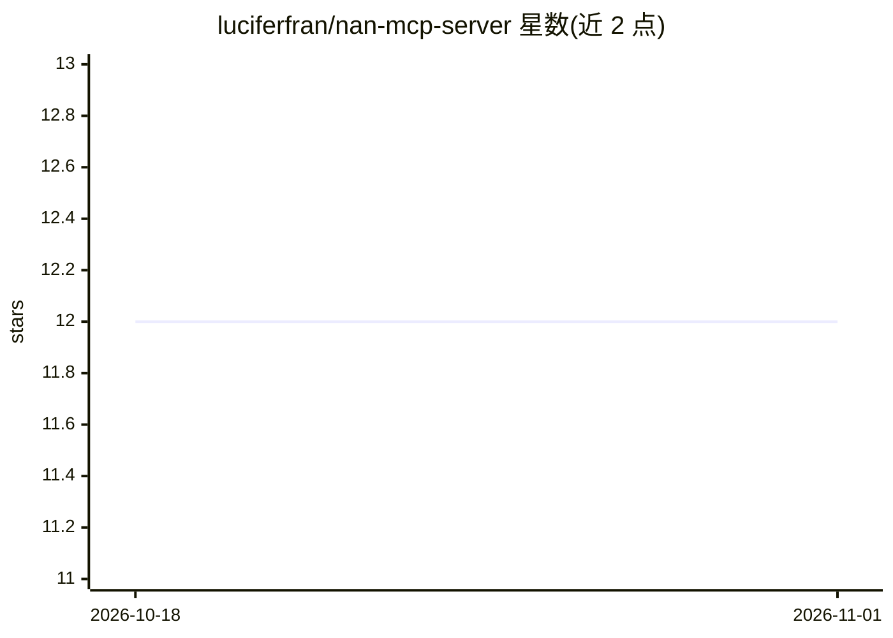

# luciferfran/nan-mcp-server

⭐ 12 · JavaScript · MIT · 推送 2026-10-25 · [GitHub](https://github.com/luciferfran/nan-mcp-server) · 个人维护

**MCP 服务器：向 MCP 客户端暴露 NaN API 的图像、语音与嵌入工具**

通过 stdio 运行的 Node.js MCP 服务器，把 NaN API（api.nan.builders）的媒体能力暴露给任意 MCP 兼容客户端（opencode、Claude Code、Codex、Cursor、Windsurf、Zed 等）：文生图/图生图（flux-2-klein）、TTS（kokoro）与语音列表、语音转文字（whisper）、4096 维嵌入（qwen3-embedding）与 RAG 重排序。需要 NaN API key 才能调用工具；经 npx 直接运行或全局安装。API 有限额：图像生成 100 次/月、单文件上限 25 MB、转写音频约 2 分钟。

## 筛选速览

| 维度 | 判定 | 备注 |
|---|---|---|
| AI 角色 | `ai-ecosystem` | LLM/agent 周边工具 |
| 许可风险 | `permissive` | MIT |
| 部署形态 | `library` | 以包/库形式分发 |
| 模型依赖 | — | README 未给出锁定关系 |
| 硬件要求 | — | 无带数字的原话,不猜 |
| 安装摩擦 | `low` | 无编译、无系统依赖或容器化 |
| 成熟度 | — | 结构信号不足 |

## 能力要点

- 图像生成/编辑（flux-2-klein）、TTS（kokoro）、STT（whisper）、嵌入与重排序共 8 个工具
- npx 即取即用，兼容 opencode/Claude Code/Codex/Pi/Cursor/Windsurf/Zed
- 输出文件保存至 ~/nan-mcp-output，文件名消毒且不覆盖已有文件
- 测试用 node:test 原生运行，无需网络与真实凭据

## 适用场景

- 在 MCP 客户端/编程助手中直接调用图像生成、语音合成与转写
- 为 RAG 流程补充嵌入与文档重排序能力
- 查询 API 配额与可用模型列表

## 场景标签

`图像生成` `语音合成` `语音识别` · 领域:内容生成

## 证据(README 行号)

> L10: Servidor MCP (Model Context Protocol) que expone las herramientas de media de la API de NaN (`api.nan.builders`) pa
> L12: Al ser un estándar abierto, funciona con **opencode**, **Claude Code**, **Codex**, **Pi**, **Cursor**, **Windsurf**

## 星数曲线

2026-10-18 12 → 2026-11-01 12（+0）

---
*卡片 v1 · prompt 1.4 · 生成 2026-11-01 · 置信度 high · 依据 README sha `058be308200d` · [字段定义](../../DATASET.md)*
