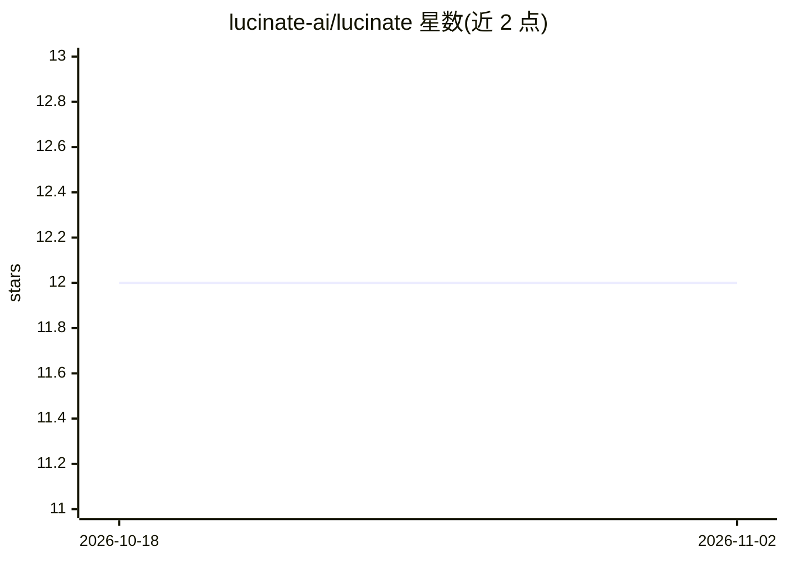

# lucinate-ai/lucinate

⭐ 12 · Go · Apache-2.0 · 推送 2026-10-31 · [GitHub](https://github.com/lucinate-ai/lucinate) · [官网](https://lucinate.ai) · 组织维护

**终端原生 AI 聊天客户端，接入 OpenClaw/Hermes/Ollama 等后端**

用 Go 编写的终端 TUI 聊天客户端，面向在终端中使用 AI agent 的用户。支持三类连接：OpenClaw 网关（WebSocket + Ed25519 设备配对）、任意 OpenAI 兼容端点（Ollama/vLLM/LM Studio/llamafile/OpenAI）、Hermes Agent profile。功能包括流式响应、markdown 渲染、消息队列、本地/远程 shell 命令、多步 routine 回放、本地技能目录（~/.agents/skills/）；cron 浏览、token/成本统计与思考级别控制仅限 OpenClaw 后端。安装提供 Homebrew、安装脚本、go install 与源码构建四种途径。

## 筛选速览

| 维度 | 判定 | 备注 |
|---|---|---|
| AI 角色 | `ai-native` | 本体是模型或模型工具 |
| 许可风险 | `permissive` | Apache-2.0 |
| 部署形态 | `library` | 以包/库形式分发 |
| 模型依赖 | local-ok | 支持本地模型 |
| 硬件要求 | — | 无带数字的原话,不猜 |
| 安装摩擦 | `low` | 无编译、无系统依赖或容器化 |
| 成熟度 | — | 结构信号不足 |

## 能力要点

- 三类后端连接：OpenClaw 网关、OpenAI 兼容端点、Hermes profile
- OpenClaw 下支持 Ed25519 设备配对、cron 浏览、token/成本统计、思考级别控制
- 本地技能目录与多步 routine（客户端侧，全后端可用）
- lucinate send 一次性发送消息并输出到 stdout，可管道/定时使用

## 适用场景

- 在终端与 OpenClaw agent 或本地 Ollama 模型对话
- 把常用多步提示工作流保存为 routine 反复执行
- 脚本中通过 lucinate send 单次调用并捕获回复

## 场景标签

`聊天机器人` · 领域:对话与助手

## 证据(README 行号)

> L3:  lucinate — the terminal-native AI chat client
> L5:  Chat with your OpenClaw agents, a Hermes profile, or any OpenAI-compatible endpoint (Ollama, vLLM, LM Studio, OpenA
> L74: - **OpenAI-compatible** — Ollama, vLLM, LM Studio, llamafile, OpenAI - connect to any `/v1/chat/completions` endpoi

## 星数曲线

2026-10-18 12 → 2026-11-02 12（+0）

---
*卡片 v1 · prompt 1.4 · 生成 2026-11-01 · 置信度 high · 依据 README sha `454fa4954893` · [字段定义](../../DATASET.md)*
