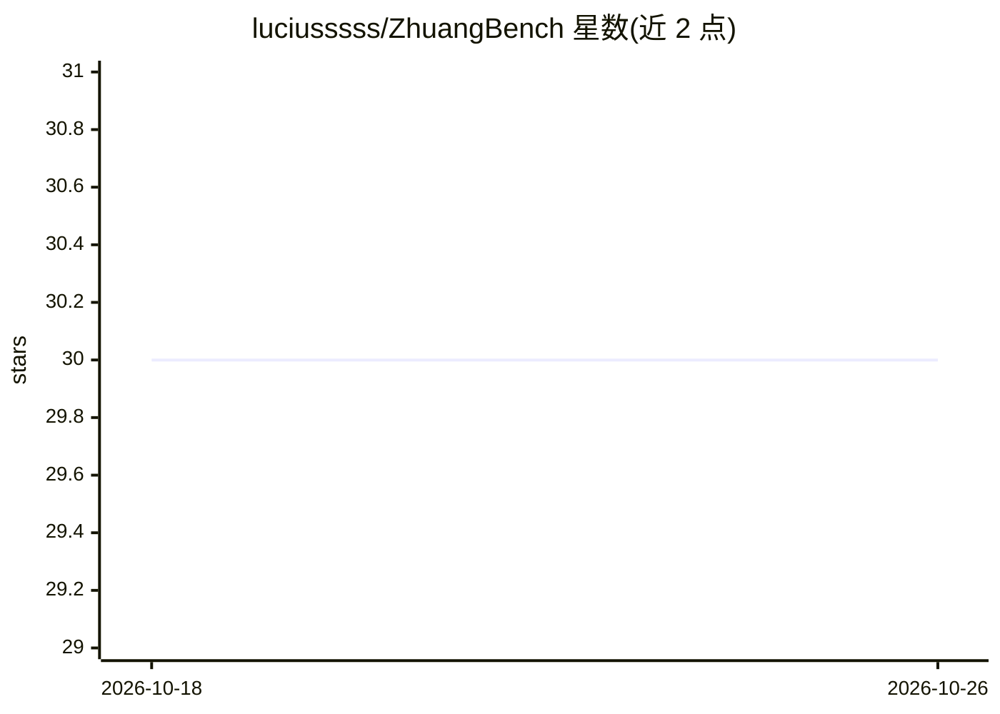

# luciusssss/ZhuangBench

⭐ 30 · Python · MIT · 推送 2026-01-06 · [GitHub](https://github.com/luciusssss/ZhuangBench) · 组织维护 · 中文 README

**壮语低资源 NLP 数据集及 DiPMT++ 复现代码**

ACL'24 Findings 论文 Teaching Large Language Models an Unseen Language on the Fly 的数据与代码仓库。提供 ZhuangBench：壮-汉双语词典、平行语料与机器翻译测试集，源文件以 zip 加密（密码 zhuangbench）防止测试集污染；另含 ICLR'24 Tiny Paper 使用的 Beta 版数据（仅存档用途）。代码部分提供 DiPMT++ 复现脚本，通过 pip 安装依赖后在 scripts 目录运行 LLM 与评估。代码与数据均以 MIT 许可发布。

## 筛选速览

| 维度 | 判定 | 备注 |
|---|---|---|
| AI 角色 | `ai-knowledge` | 知识聚合/清单类 |
| 许可风险 | `permissive` | MIT |
| 部署形态 | `library` | 以包/库形式分发 |
| 模型依赖 | — | README 未给出锁定关系 |
| 硬件要求 | — | 无带数字的原话,不猜 |
| 安装摩擦 | `low` | 无编译、无系统依赖或容器化 |
| 成熟度 | — | 结构信号不足 |

## 能力要点

- 壮-汉词典、平行语料与机翻测试集三部分数据
- zip 加密源文件以防止测试集污染
- 提供 DiPMT++ 论文结果复现代码与运行脚本
- 含 Giza++ 增强的预处理词典版本

## 适用场景

- 研究低资源语言的 LLM 即时学习能力评测
- 获取壮语-汉语翻译的基准测试数据
- 复现论文中 DiPMT++ 方法的实验结果

## 场景标签

`模型评测` · 领域:评测与运维

## 证据(README 行号)

> L12: We present ZhuangBench, a collection of NLP resources for Zhuang (壮语), a low-resource language spoken in China.
> L14: It consists of a Zhuang-Chinese dictionary, a Zhuang-Chinese parallel corpus, and Zhuang-Chinese machine translatio
> L33: We provide code of DiPMT++ to reproduce the results in the paper.

## 星数曲线

2026-10-18 30 → 2026-10-26 30（+0）

---
*卡片 v1 · prompt 1.4 · 生成 2026-10-26 · 置信度 high · 依据 README sha `8110aee74abb` · [字段定义](../../DATASET.md)*
