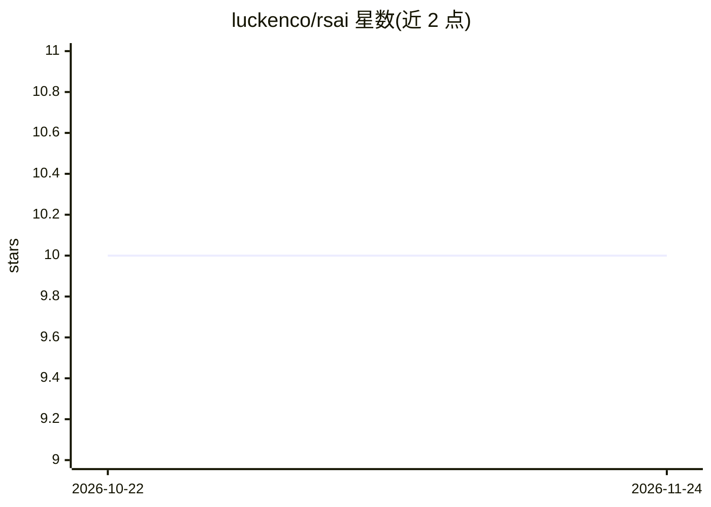

# luckenco/rsai

⭐ 10 · Rust · MIT · 推送 2026-08-11 · [GitHub](https://github.com/luckenco/rsai) · [官网](https://rsai.dev/) · 个人维护

**Rust 类型安全 LLM 客户端：结构化输出与工具调用**

rsai 是一个 Rust 编写的 LLM 客户端库，提供带类型验证的生成与自动工具调用：结构体/枚举通过 #[completion_schema] 派生 JSON Schema 并拒绝未知字段，函数以 #[tool] 注解后经 toolset! 收集并在执行前做 schema 校验。设计上不支持流式输出，调用方要么得到完整合法值要么得到错误。支持 OpenAI、OpenRouter、Google Gemini 三家 API，通过环境变量或自定义 key 鉴权。当前为预发布版本，API 不稳定，建议生产环境锁定版本。

## 筛选速览

| 维度 | 判定 | 备注 |
|---|---|---|
| AI 角色 | `ai-ecosystem` | LLM/agent 周边工具 |
| 许可风险 | `permissive` | MIT |
| 部署形态 | `None` |  |
| 模型依赖 | locked-api |  |
| 硬件要求 | — | 无带数字的原话,不猜 |
| 安装摩擦 | `low` | 无编译、无系统依赖或容器化 |
| 成熟度 | `idea` | |

## 能力要点

- #[completion_schema] 类型化结构化输出解析，支持结构体与枚举
- #[tool] 注解函数式工具调用，参数执行前做 schema 校验
- 支持共享上下文工具（Ctx<&T>）与工具循环并发/超时配置
- builder 提供 max_tokens、temperature、HTTP 客户端等生成配置

## 适用场景

- 在 Rust 项目中以类型安全方式接入 LLM 结构化输出
- 为 LLM 编写带 schema 验证的函数调用工具集
- 需要完整响应而非流式 token 的生成场景

## 场景标签

`Agent 框架` · 领域:Agent 开发

## 证据(README 行号)

> L7: rsai is an opinionated Rust client for typed LLM generation and automatic tool calling. It favors complete validatio
> L9: ## Supported Providers

## 星数曲线

2026-10-22 10 → 2026-11-24 10（+0）

---
*卡片 v1 · prompt 1.4 · 生成 2026-11-19 · 置信度 high · 依据 README sha `01140a134daa` · [字段定义](../../DATASET.md)*
