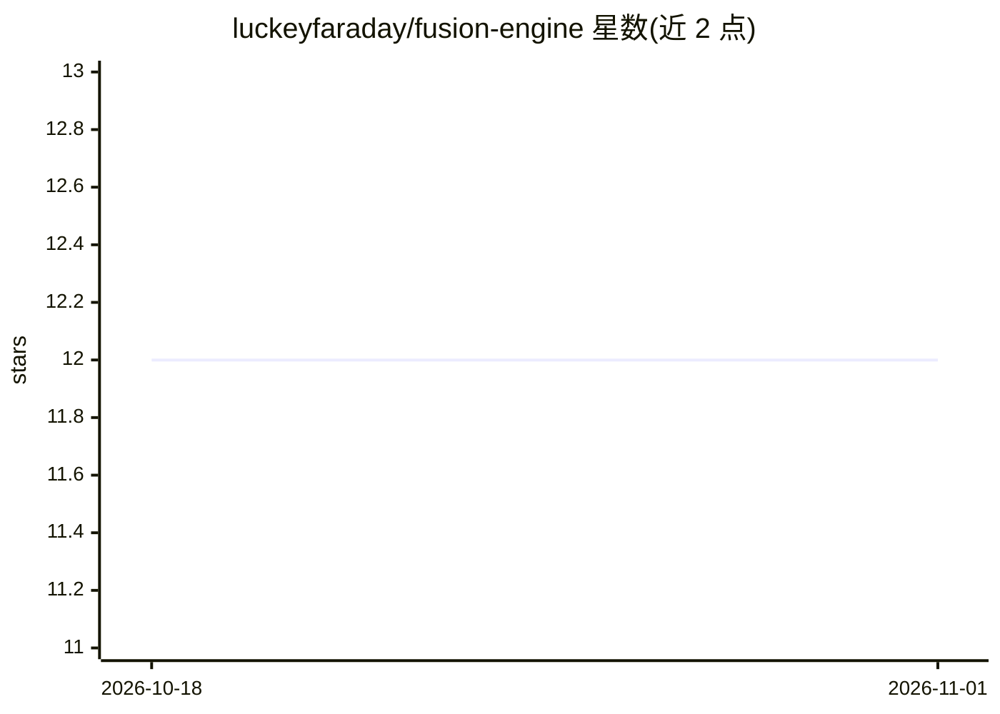

# luckeyfaraday/fusion-engine

⭐ 12 · Python · MIT · 推送 2026-06-27 · [GitHub](https://github.com/luckeyfaraday/fusion-engine) · 个人维护

**自托管多模型 LLM 融合框架：一个提示分发给 N 个模型再由裁判模型合成**

Python 编写的自托管 LLM 编排框架：通过 OpenRouter 将同一提示并行发给多个模型，收集各响应的 token、延迟与成本数据，再由可配置的裁判模型合成单一回答。提供 Python 库、CLI、FastAPI 服务与 OpenAI 兼容的 /v1/chat/completions 网关；面板定义存于 panels/*.json，裁判提示为可编辑的 Markdown 模板。附带 GSM8K/HumanEval/MMLU/GPQA 评测框架。模型调用依赖 OpenRouter API key，自身不提供模型。

## 筛选速览

| 维度 | 判定 | 备注 |
|---|---|---|
| AI 角色 | `ai-ecosystem` | LLM/agent 周边工具 |
| 许可风险 | `permissive` | MIT |
| 部署形态 | `library` | 以包/库形式分发 |
| 模型依赖 | locked-api |  |
| 硬件要求 | — | 无带数字的原话,不猜 |
| 安装摩擦 | `low` | 无编译、无系统依赖或容器化 |
| 成熟度 | — | 结构信号不足 |

## 能力要点

- 一提示并行分发给 N 个模型，裁判模型合成单一回答
- OpenAI 兼容 /v1/models 与 /v1/chat/completions 端点，模型列表为 fusion/<panel>
- 面板定义（panels/*.json）与裁判提示模板（judges/*.md）以文件形式可编辑
- 内置 GSM8K、HumanEval、MMLU、GPQA 及自定义 JSONL 评测框架

## 适用场景

- 为 AI agent 后端提供多模型融合的 OpenAI 兼容 API
- 对比多个模型对同一问题的回答、成本与延迟
- 用裁判模板做代码评审或研究综合的融合工作流

## 场景标签

`模型网关` `模型评测` · 领域:Agent 开发

## 证据(README 行号)

> L24: Use Fusion Engine as a Python library, CLI, FastAPI service, or
> L47: Fusion Engine is an open-source Python framework for **parallel LLM inference**,
> L71: - **Project type:** self-hosted OpenRouter Fusion API, LLM ensemble framework,

## 星数曲线

2026-10-18 12 → 2026-11-01 12（+0）

---
*卡片 v1 · prompt 1.4 · 生成 2026-11-01 · 置信度 high · 依据 README sha `a33f37a58e5a` · [字段定义](../../DATASET.md)*
