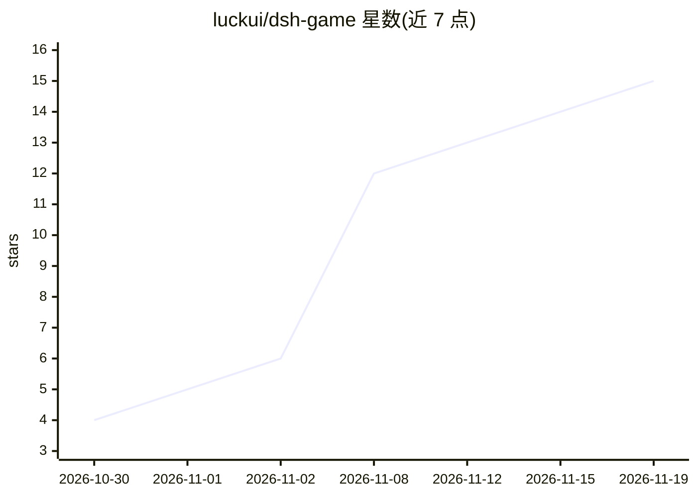

# luckui/dsh-game

⭐ 15 · TypeScript · NOASSERTION · 推送 2026-10-26 · [GitHub](https://github.com/luckui/dsh-game) · 个人维护 · 中文 README

**让 AI agent 自动玩狼人杀、Minecraft 等游戏的 DSH 插件**

DeepSeek Harness（DSH）的插件，安装后 DSH 的 agent 以「大肥鱼」身份自动操作三款游戏：自带的九位 AI 娘狼人杀（可换模型、可上桌对局）、Steam 版《心跳文学部》通关、Java 版 Minecraft 生存（建房/种地/下界等）。游戏画面与思考过程在 DSH 界面展示，支持豆包语音朗读、旁观摄像机客户端、OBS 直播与玩家插话暂停。需 Windows 与已配好 DeepSeek 的 DSH 0.2.0-rc.2，暂未发布 npm，仅能从源码构建。

## 筛选速览

| 维度 | 判定 | 备注 |
|---|---|---|
| AI 角色 | `ai-native` | 本体是模型或模型工具 |
| 许可风险 | `none` | NOASSERTION |
| 部署形态 | `library` | 以包/库形式分发 |
| 模型依赖 | locked-api |  |
| 硬件要求 | — | 无带数字的原话,不猜 |
| 安装摩擦 | `low` | 无编译、无系统依赖或容器化 |
| 成熟度 | — | 结构信号不足 |

## 能力要点

- 狼人杀九个座位可分别指定模型（含本机 Codex）
- Minecraft：摄像机客户端跟随拍摄，血量/饱食度 HUD 叠加
- 《心跳文学部》由 agent 自主完成选项与写诗挑词
- 自带 Minecraft 生存自测脚本（约 30 分钟，分 7 项场景）

## 适用场景

- 旁观 AI 玩狼人杀并展示每个决策的心声
- 让 agent 在自己的 Minecraft 服务器里生存建造
- 用 OBS 把 AI 玩游戏的过程做成直播或视频

## 场景标签

`GUI 自动化` · 领域:效率与自动化

## 证据(README 行号)

> L3: **让你的 AI 自己玩游戏。** 一个 DeepSeek Harness（DSH）插件：装上以后，DSH 的 agent 会以 Q 版鲸鱼娘「大肥鱼」的身份自己操作游戏，边玩边说，你在旁边看。
> L62: 然后在 DSH 侧边栏点「插件」→「添加插件」，填 `packages/dsh-game` 的绝对路径，安装后启用。插件自带一个 agent 预设「大肥鱼玩游戏」：只有人设和游戏工具，没有文件读写和 shell。

## 星数曲线

2026-10-30 4 → 2026-11-19 15（+11）

---
*卡片 v1 · prompt 1.4 · 生成 2026-11-18 · 置信度 mid · 依据 README sha `bed83c3fc038` · [字段定义](../../DATASET.md)*
