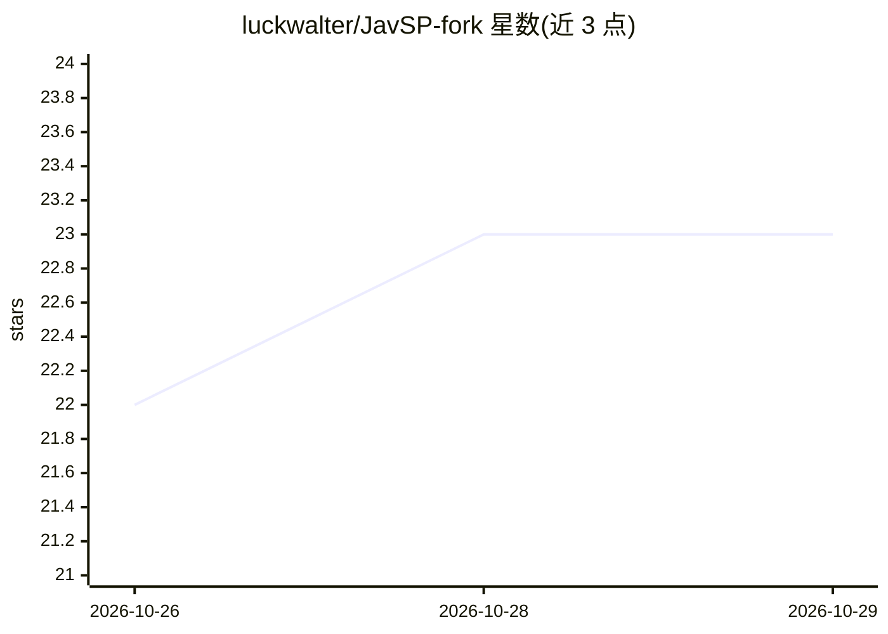

# luckwalter/JavSP-fork

⭐ 23 · Python · GPL-3.0 · 推送 2026-10-28 · [GitHub](https://github.com/luckwalter/JavSP-fork) · 个人维护 · 中文 README

**带 Web 界面的 AV 元数据刮削器，多站点汇总并生成媒体库 NFO**

Yuukiy/JavSP 的派生分支：汇总 19 个刮削源的数据自动识别番号、生成 NFO 与封面，供 Emby/Jellyfin/Kodi 媒体库使用。本 fork 新增 Vue3 Web 界面（FastAPI+SSE 后端）与 Windows 桌面 exe，支持渠道健康熔断、译文审阅后落盘、应用内一键升级。翻译功能支持百度/必应/Google/Claude/OpenAI 兼容（含本地 Ollama）引擎，项目本身不内置任何大模型，仅提供标准 OpenAI 兼容接口。Docker/NAS 与本地 Python 两种服务部署方式，明确不支持公网部署。

## 筛选速览

| 维度 | 判定 | 备注 |
|---|---|---|
| AI 角色 | `ai-enhanced` | 去掉 AI 部分产品仍成立 |
| 许可风险 | `viral` | GPL-3.0 |
| 部署形态 | `desktop` | 安装包/桌面程序 |
| 模型依赖 | local-ok | 支持本地模型 |
| 硬件要求 | — | 无带数字的原话,不猜 |
| 安装摩擦 | `low` | 无编译、无系统依赖或容器化 |
| 成熟度 | — | 结构信号不足 |

## 能力要点

- 19 个刮削源汇总数据，死源自动熔断与半开恢复
- Web 界面 + Windows 桌面 exe 双形态交付，应用内一键升级（sha256 校验）
- 标题/简介翻译支持 OpenAI 兼容接口直连本地 Ollama，译文可审阅后再落盘
- 输出项（poster/fanart/剧照/NFO）可逐项关闭

## 适用场景

- 给 Emby/Jellyfin/Kodi 媒体库批量刮削并整理影片元数据
- 在 NAS 上以 Docker 方式扫描和整理媒体目录
- 用本地 Ollama 翻译标题与简介后再入库

## 场景标签

`网页抓取` · 领域:效率与自动化

## 证据(README 行号)

> L9: > **本项目是 Yuukiy/JavSP 的派生分支。** 原项目是一个非常优秀的命令行刮削器，但自 **2025 年 2 月起已停止更新**（大量 issue 与 PR 无人处理，多个站点改版后失效无人修复）。本 fork 完整
> L211: **设计决策：只做自定义接口，不在项目内集成任何大模型**。把某个模型/推理框架内置进本项目会让软件迅速臃肿（模型文件、依赖、GPU/CPU 适配都是无底洞），且用户的硬件与网络条件千差万别。因此本项目只提供**标准 OpenA

## 星数曲线

2026-10-26 22 → 2026-10-29 23（+1）

---
*卡片 v1 · prompt 1.4 · 生成 2026-10-28 · 置信度 mid · 依据 README sha `c6f55622eedc` · [字段定义](../../DATASET.md)*
