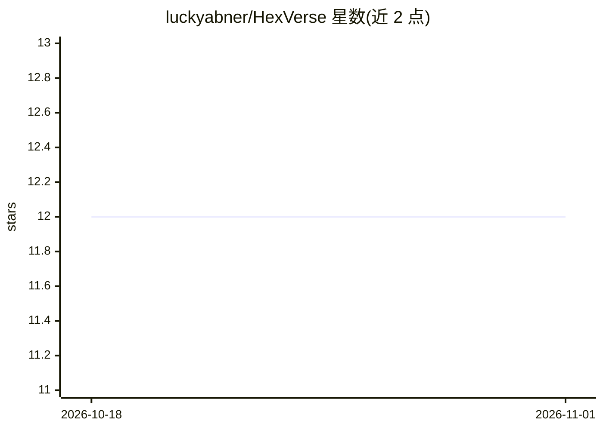

# luckyabner/HexVerse

⭐ 12 · TypeScript · MIT · 推送 2026-10-20 · [GitHub](https://github.com/luckyabner/HexVerse) · [官网](https://hexverse.luckyabner.top) · 个人维护 · 中文 README

**AI 玄学占卜应用：小六壬、六爻与命理分析**

基于 Next.js、Tailwind CSS、Vercel AI SDK 与火山引擎 API 构建的算命应用，提供小六壬、六爻、命理分析三种功能。以 Web 应用形式交付，作者提供在线体验地址。部署方式为克隆仓库后用 pnpm 安装依赖、按 env.example 配置环境变量、运行开发服务器，采用 MIT 许可证。README 未说明具体使用的模型或占卜输出的详细机制。

## 筛选速览

| 维度 | 判定 | 备注 |
|---|---|---|
| AI 角色 | `ai-native` | 本体是模型或模型工具 |
| 许可风险 | `permissive` | MIT |
| 部署形态 | `library` | 以包/库形式分发 |
| 模型依赖 | — | README 未给出锁定关系 |
| 硬件要求 | — | 无带数字的原话,不猜 |
| 安装摩擦 | `low` | 无编译、无系统依赖或容器化 |
| 成熟度 | — | 结构信号不足 |

## 能力要点

- 小六壬、六爻、命理分析三种占卜功能
- 基于 Vercel AI SDK 与火山引擎 API 构建
- 提供在线体验地址

## 适用场景

- 在线进行小六壬、六爻占卜
- 获取 AI 生成的命理分析
- 自行部署一个 AI 占卜站点

## 场景标签

`AI 写作` `聊天机器人` · 领域:对话与助手

## 证据(README 行号)

> L3: _AI与玄学的结合，体验地址👉HeVerse_
> L16: - 小六壬
> L17: - 六爻
> L18: - 命理分析

## 星数曲线

2026-10-18 12 → 2026-11-01 12（+0）

---
*卡片 v1 · prompt 1.4 · 生成 2026-11-01 · 置信度 high · 依据 README sha `a5bf29628b6a` · [字段定义](../../DATASET.md)*
