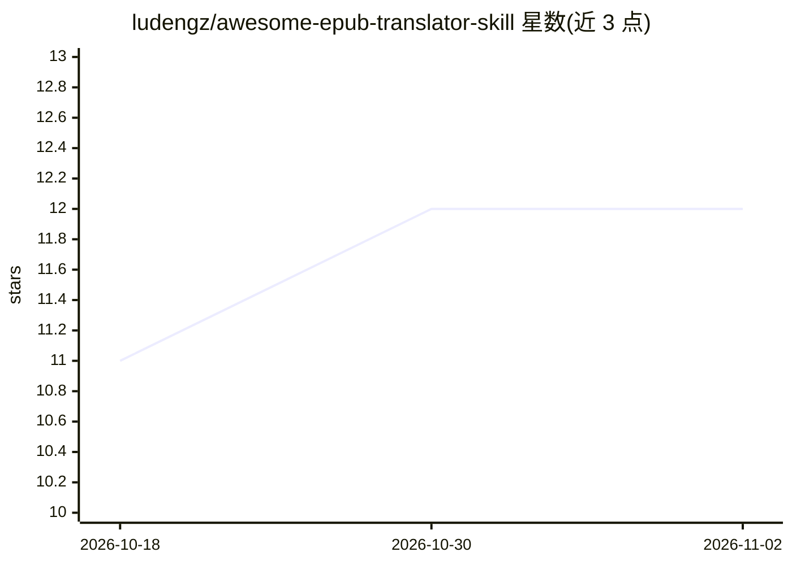

# ludengz/awesome-epub-translator-skill

⭐ 12 · 推送 2026-03-26 · [GitHub](https://github.com/ludengz/awesome-epub-translator-skill) · 个人维护 · 中文 README

**给 Claude Code 用户的 ePub 整书翻译技能插件**

以纯 Markdown 提示指令实现的 Claude Code 插件：对 ePub 2/3 电子书做整书翻译，流程为解包校验、生成风格画像、最多 3 个 Claude 子代理并行翻译、完整性校验与自动重试、重打包，支持双语对照输出与断点续传，原文件不被修改。依赖 Claude Code CLI 与 unzip/zip（或 Python 3）等系统工具，无外部翻译服务与 API key。不支持图片内文字翻译，拒处理 DRM 加密文件。

## 筛选速览

| 维度 | 判定 | 备注 |
|---|---|---|
| AI 角色 | `ai-native` | 本体是模型或模型工具 |
| 许可风险 | `permissive` | — |
| 部署形态 | `None` |  |
| 模型依赖 | locked-api |  |
| 硬件要求 | — | 无带数字的原话,不猜 |
| 安装摩擦 | `low` | 无编译、无系统依赖或容器化 |
| 成熟度 | — | 结构信号不足 |

## 能力要点

- 3 个 Claude 子代理并行翻译与大小感知分派
- 翻译前生成风格画像并注入每个翻译批次
- 双语对照模式与断点续传
- DRM 检测并拒绝处理加密文件

## 适用场景

- 把技术书或小说整本翻译成另一语言并保留原文风格
- 语言学习者用双语模式对照阅读
- 分轮暂停检查翻译质量后续传

## 场景标签

 · 领域:AI 翻译/电子书工具

## 证据(README 行号)

> L5: > Built entirely in Markdown. No Python. No JavaScript. Just prompt instructions that dispatch 3 parallel Claude age
> L44: - **Parallel 3-agent architecture** — three Claude subagents translate concurrently with size-aware file dispatch, 

## 星数曲线

2026-10-18 11 → 2026-11-02 12（+1）

---
*卡片 v1 · prompt 1.4 · 生成 2026-11-01 · 置信度 high · 依据 README sha `7988ddb4b6f5` · [字段定义](../../DATASET.md)*
