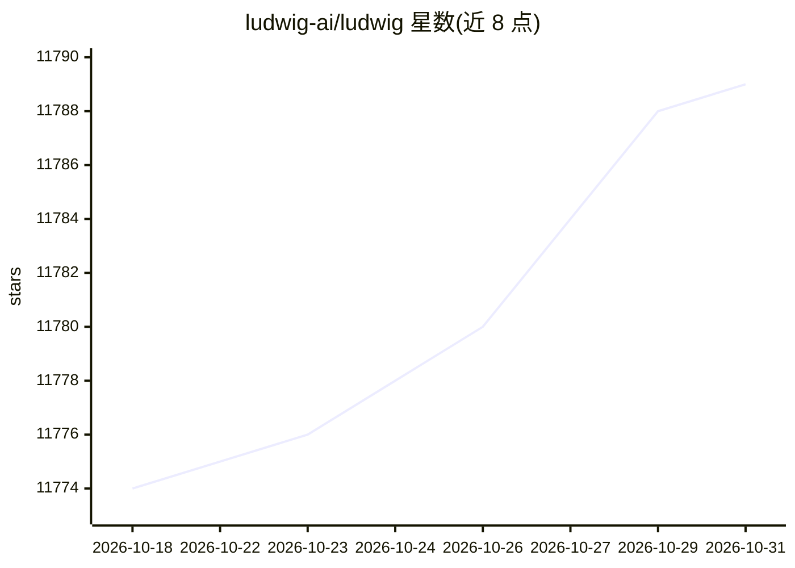

# ludwig-ai/ludwig

⭐ 11,789 · Python · Apache-2.0 · 推送 2026-10-27 · [GitHub](https://github.com/ludwig-ai/ludwig) · [官网](http://ludwig.ai) · 组织维护

**YAML 声明式深度学习框架：训练/微调/部署 LLM 与多模态模型**

面向开发者的低代码深度学习框架：通过 YAML 配置文件完成 LLM 微调（SFT、DPO/KTO/ORPO/GRPO 对齐、LoRA/QLoRA 等 PEFT、VLM 微调）、表格/多模态/时序模型训练，以及预测与 REST API 部署（FastAPI、vLLM、Ray Serve、KServe）。内置 AutoML、超参优化（Ray Tune/Optuna）、70+ 基准数据集与实验跟踪集成。技术栈要求 Python 3.12+、PyTorch 2.7+，由 Linux Foundation AI & Data 托管。

## 筛选速览

| 维度 | 判定 | 备注 |
|---|---|---|
| AI 角色 | `ai-ecosystem` | LLM/agent 周边工具 |
| 许可风险 | `permissive` | Apache-2.0 |
| 部署形态 | `library` | 以包/库形式分发 |
| 模型依赖 | — | README 未给出锁定关系 |
| 硬件要求 | — | 无带数字的原话,不猜 |
| 安装摩擦 | `low` | 无编译、无系统依赖或容器化 |
| 成熟度 | — | 结构信号不足 |

## 能力要点

- YAML 单文件声明式训练，零样板代码
- 全谱系 LLM 微调：SFT/DPO/KTO/ORPO/GRPO 与 10+ 种 PEFT 适配器
- 多模态输入覆盖文本/图像/音频/时序/表格，含图像分割与时序预测
- ludwig serve/generate_config 命令与 vLLM/Ray Serve/KServe 部署路径

## 适用场景

- 用一份 YAML 配置完成 Llama 类模型的 LoRA/QLoRA 微调
- 混合文本、图像、数值等多模态特征的分类或回归任务
- 给数据集和时间预算，让 AutoML 自动搜索模型结构
- 把训练好的模型导出为 REST API 或推送至 HuggingFace Hub

## 场景标签

`微调` `模型训练` `多模态` · 领域:感知与多模态

## 证据(README 行号)

> L5: **Declarative deep learning framework for LLMs, multimodal models, and tabular AI.**
> L18: Ludwig is a **declarative deep learning framework** that lets you train, fine-tune, and deploy AI models — from LLM
> L31: **Tech stack:** Python 3.12 · PyTorch 2.7+ · Pydantic 2 · Transformers 5 · Ray 2.54

## 星数曲线

2026-10-18 11,774 → 2026-10-31 11,789（+15）

---
*卡片 v1 · prompt 1.4 · 生成 2026-10-20 · 置信度 high · 依据 README sha `b21a5366b6c9` · [字段定义](../../DATASET.md)*
