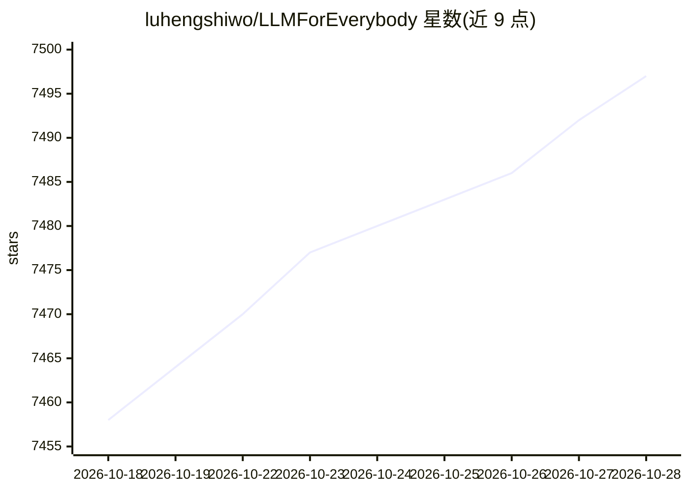

# luhengshiwo/LLMForEverybody

⭐ 7,503 · Jupyter Notebook · Apache-2.0 · 推送 2026-08-28 · [GitHub](https://github.com/luhengshiwo/LLMForEverybody) · [官网](https://www.learnllm.ai) · 组织维护 · 中文 README

**面向求职者的大模型中文知识库与面试题库**

LearnLLM.AI 团队维护的大模型中文学习内容合集：包含按时间线组织的精选论文列表（2017 Transformer 至 2025 Gemma 3）、AGI 技术路线图，以及十一章主题内容，覆盖预训练架构、优化器、注意力机制、Tokenizer、并行策略、训练框架、部署与推理、微调、量化、显卡、Prompt 工程、Agent、RAG、企业落地、评估指标与基础数学等。配套 Bilibili/YouTube 视频教程、微信公众号/知乎/CSDN/掘金渠道，并推广付费实战课程（含 GitHub 用户优惠码）。内容以文章链接形式组织，非可安装软件。

## 筛选速览

| 维度 | 判定 | 备注 |
|---|---|---|
| AI 角色 | `ai-knowledge` | 知识聚合/清单类 |
| 许可风险 | `permissive` | Apache-2.0 |
| 部署形态 | `None` |  |
| 模型依赖 | — | README 未给出锁定关系 |
| 硬件要求 | — | 无带数字的原话,不猜 |
| 安装摩擦 | `low` | 无编译、无系统依赖或容器化 |
| 成熟度 | — | 结构信号不足 |

## 能力要点

- 按时间线整理 2017-2025 大模型论文列表并持续更新
- 十一章主题覆盖预训练/推理/微调/量化/Agent/RAG/评估等方向
- 配套 Bilibili 与 YouTube 视频教程
- 多语言 README（中/英/俄）

## 适用场景

- 大模型岗位面试前系统复习知识点
- 按主题索引查找特定技术（如 MLA、RoPE、QLoRA）的讲解文章
- 从零搭建大模型知识体系的学习路线参考

## 场景标签

`教程课程` `精选清单` · 领域:学习与行业

## 证据(README 行号)

> L19:  **精选大模型面试题库**：覆盖从基础到前沿的实战题目，助您高效备战求职，抓住职业机遇；
> L21:  **系统化论文研读**：从2017年Transformer奠基性论文出发，按清晰的知识体系梳理技术演进，适合不同基础的开发者循序渐进地深度提升；
> L43: |时间|论文|介绍|视频|开始学习|

## 星数曲线

2026-10-18 7,458 → 2026-10-28 7,497（+39）

---
*卡片 v1 · prompt 1.4 · 生成 2026-10-20 · 置信度 high · 依据 README sha `571bad6fcb55` · [字段定义](../../DATASET.md)*
