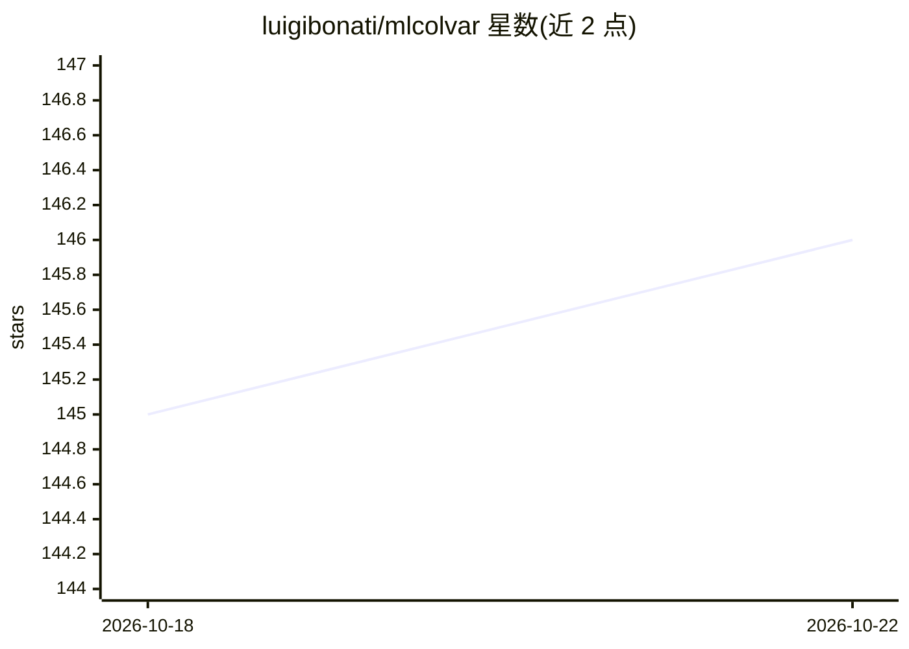

# luigibonati/mlcolvar

⭐ 147 · Python · MIT · 推送 2026-10-13 · [GitHub](https://github.com/luigibonati/mlcolvar) · 组织维护

**供模拟开发者设计数据驱动集合变量的 Python 库**

mlcolvar 是面向增强采样分子模拟的 Python 库，用于设计数据驱动的集合变量（CVs）。它提供统一框架来测试和使用文献中提出的多种 CV 方法，包括无监督的 PCA、AutoEncoder，监督的 DeepLDA、DeepTDA，以及时间信息类的 TICA、DeepTICA 等。库基于 PyTorch 与 Lightning 构建，提供模块化接口便于开发新方法。所得 CVs 可通过 PLUMED 2.9 以上的 pytorch 接口部署用于增强采样。早期版本（v<=0.2.*）名为 mlcvs。

## 筛选速览

| 维度 | 判定 | 备注 |
|---|---|---|
| AI 角色 | `ai-native` | 本体是模型或模型工具 |
| 许可风险 | `permissive` | MIT |
| 部署形态 | `library` | 以包/库形式分发 |
| 模型依赖 | — | README 未给出锁定关系 |
| 硬件要求 | — | 无带数字的原话,不猜 |
| 安装摩擦 | `low` | 无编译、无系统依赖或容器化 |
| 成熟度 | — | 结构信号不足 |

## 能力要点

- 实现多种 CV 方法：AutoEncoder、DeepLDA、DeepTDA、TICA、DeepTICA 等
- 基于 PyTorch 与 Lightning 构建的模块化接口
- 支持通过 PLUMED pytorch 接口（≥2.9）部署 CVs 用于增强采样
- 提供教程与示例文档（readthedocs）

## 适用场景

- 为增强采样模拟设计数据驱动集合变量
- 测试和对比文献中提出的各类 CV 方法
- 基于现有构件开发新的 CV 方法

## 场景标签

 · 领域:计算化学/分子模拟

## 证据(README 行号)

> L14: `mlcolvar` is a Python library aimed to help design data-driven collective-variables (CVs) for enhanced sampling si
> L20: The library is built upon the PyTorch ML library as well as the Lightning high-level framework.

## 星数曲线

2026-10-18 145 → 2026-10-22 146（+1）

---
*卡片 v1 · prompt 1.4 · 生成 2026-10-22 · 置信度 high · 依据 README sha `f04db8838dbe` · [字段定义](../../DATASET.md)*
