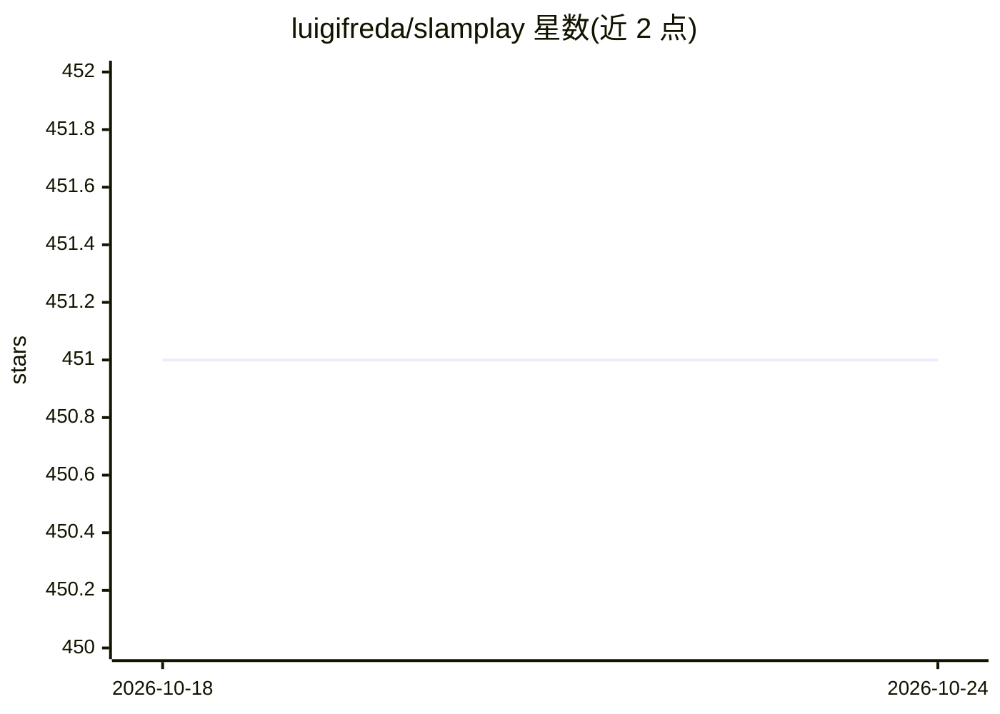

# luigifreda/slamplay

⭐ 451 · C++ · 推送 2026-05-19 · [GitHub](https://github.com/luigifreda/slamplay) · 个人维护

**C++ SLAM 实验框架：一站式整合前后端与深度学习工具链**

为在教学与自学场景中动手实验 SLAM 而构建的 C++/CMake 工程：把 g2o、gtsam、ceres 等后端优化框架，OpenCV、PCL 等前端工具，pangolin/rerun 等可视化库，以及 TensorRT/onnxruntime 等深度学习推理工具安装并接线到统一构建中，附带注释示例。提供视觉 SLAM 与 LiDAR-惯性 SLAM 两条端到端流水线及分步程序，含 SuperPoint/SuperGlue、Depth-Anything、SAM 等模型集成。在 Ubuntu 20.04/22.04/24.04 测试，通过脚本安装依赖并从源码构建，无需系统 ROS；GPLv3 许可。

## 筛选速览

| 维度 | 判定 | 备注 |
|---|---|---|
| AI 角色 | `ai-ecosystem` | LLM/agent 周边工具 |
| 许可风险 | `none` | — |
| 部署形态 | `None` |  |
| 模型依赖 | — | README 未给出锁定关系 |
| 硬件要求 | — | 无带数字的原话,不猜 |
| 安装摩擦 | `high` | 编译与系统依赖俱全 |
| 成熟度 | — | 结构信号不足 |

## 能力要点

- 单一 CMake 框架整合 g2o/gtsam/ceres 等后端与 OpenCV/PCL 等前端工具
- 视觉 SLAM 与 LiDAR-惯性 SLAM 端到端流水线及分步运行程序
- TensorRT/onnxruntime 集成 SuperPoint/SuperGlue、Depth-Anything-V2、HFNet、SAM 等 DL 模型
- 内置最小 ROS1 兼容子集读取 .bag，无需系统 ROS 安装

## 适用场景

- 学习与实验视觉/激光 SLAM 各组件的组合搭建
- 在 KITTI、EuRoC、NCLT 等数据集上跑 SLAM 流水线
- 课堂教学中演示 SLAM 前后端与深度学习模块

## 场景标签

 · 领域:机器人/计算机视觉（SLAM）

## 证据(README 行号)

> L10: **slamplay** is a collection of tools to start playing and experimenting with **SLAM in C++**. It installs and wire
> L64: **(*)** C++ tools based on *TensorRT*, *tensorflow_cc*, *onnxruntime* — e.g. *SuperPoint*, *SuperGlue*, *Depth-Anyt

## 星数曲线

2026-10-18 451 → 2026-10-24 451（+0）

---
*卡片 v1 · prompt 1.4 · 生成 2026-10-21 · 置信度 high · 依据 README sha `9a23da1bf69b` · [字段定义](../../DATASET.md)*
