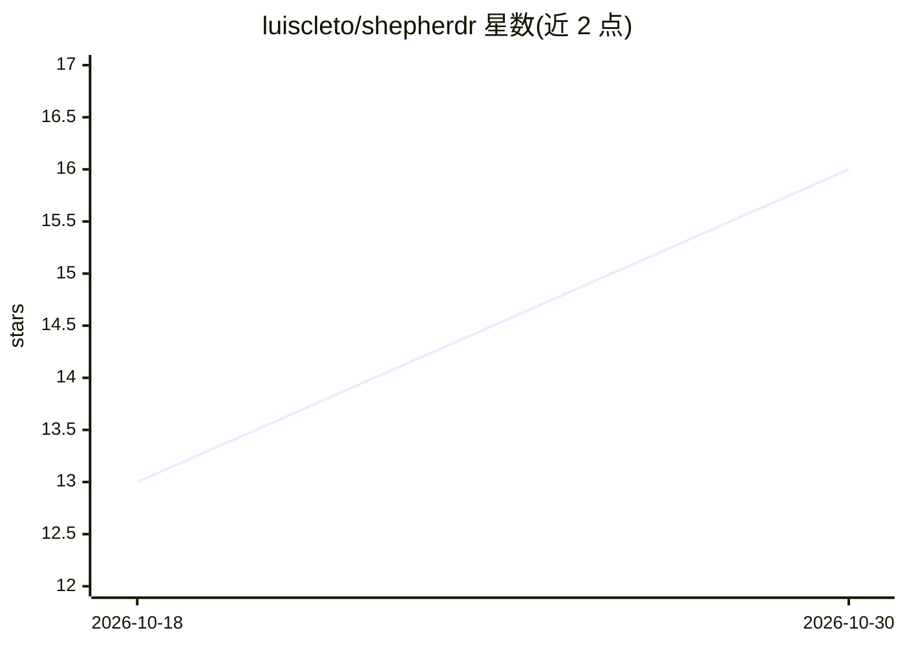

# luiscleto/shepherdr

⭐ 16 · Go · Apache-2.0 · 推送 2026-10-16 · [GitHub](https://github.com/luiscleto/shepherdr) · 个人维护

**手机网页端监控与操作 Herdr 编码 agent 的界面**

Go 编写的 Web 界面，连接本地运行的 Herdr（0.9.0+），面向从手机管理编码 agent 的开发者：分组显示终端与 agent 状态（working/blocked/idle/done/unknown），支持接收推送通知、发送文本/快捷键/文件到指定终端、管理 workspace 与 worktree。安全机制为 passkey 设备信任与回环+私网（Tailscale Serve）部署，不公开暴露；文件以绝对路径传给 agent 而非发送到模型。以预编译二进制或 go install 分发，需与 Herdr 同 OS 账户运行。

## 筛选速览

| 维度 | 判定 | 备注 |
|---|---|---|
| AI 角色 | `ai-ecosystem` | LLM/agent 周边工具 |
| 许可风险 | `permissive` | Apache-2.0 |
| 部署形态 | `library` | 以包/库形式分发 |
| 模型依赖 | — | README 未给出锁定关系 |
| 硬件要求 | — | 无带数字的原话,不猜 |
| 安装摩擦 | `low` | 无编译、无系统依赖或容器化 |
| 成熟度 | — | 结构信号不足 |

## 能力要点

- 终端状态标记与 blocked/done/登录变更推送通知
- 手机端 Reader 读终端输出、发消息/快捷键/文件，控制权需确认接管
- passkey 设备信任 + 回环/私网部署，无账号密码
- workspace/worktree 创建与关闭管理

## 适用场景

- 离开电脑时用手机查看各编码 agent 终端状态并接收阻塞通知
- 手机上向指定 agent 终端发送消息、快捷键与文件
- 在私网内远程管理 Herdr workspace 与 worktree

## 场景标签

 · 领域:开发者工具/agent 运维

## 证据(README 行号)

> L11: **herdr, from your phone.**
> L13: - **never hunt for the stuck one** — every terminal is marked working, blocked, idle, done, or unknown. when an age
> L14: - **open the exact terminal** — read it, send text or shortcuts, and attach files while an agent is there. shepherd

## 星数曲线

2026-10-18 13 → 2026-10-30 16（+3）

---
*卡片 v1 · prompt 1.4 · 生成 2026-10-30 · 置信度 high · 依据 README sha `2de438d43624` · [字段定义](../../DATASET.md)*
