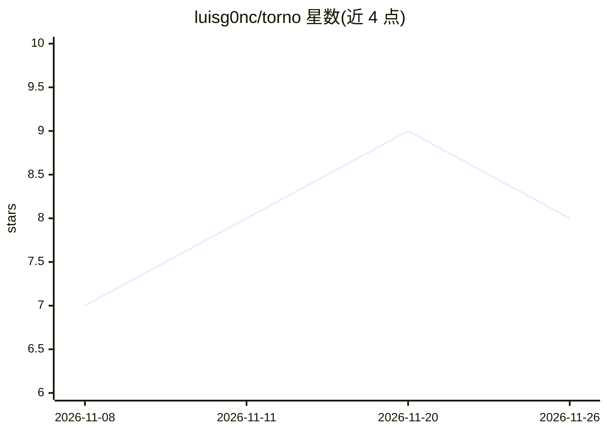

# luisg0nc/torno

⭐ 8 · TypeScript · Apache-2.0 · 推送 2026-11-20 · [GitHub](https://github.com/luisg0nc/torno) · [官网](https://torno.luisg.me) · 个人维护

**配合 Claude Code 的桌面 CAD 工作台，保存即重建模型**

Electron + three.js 桌面应用，用于以 AI 编码代理生成参数化 CAD 零件：用户在 3D 视图上钉注、测量、描画标记，torno 将引用与提示发送给 Claude Code，代理用 Python 的 build123d（OpenCascade 内核）编写模型，每次保存即重建并更新视图。代理通过 MCP 工具（look/measure/section/check/diff 等）检视自己的产出。不带特征树、不能手工编辑实体；仅支持 Linux/macOS，需 Node.js 22.12+、pnpm、uv 与已登录的 claude CLI。

## 筛选速览

| 维度 | 判定 | 备注 |
|---|---|---|
| AI 角色 | `ai-native` | 本体是模型或模型工具 |
| 许可风险 | `permissive` | Apache-2.0 |
| 部署形态 | `library` | 以包/库形式分发 |
| 模型依赖 | locked-api |  |
| 硬件要求 | — | 无带数字的原话,不猜 |
| 安装摩擦 | `low` | 无编译、无系统依赖或容器化 |
| 成熟度 | `idea` | |

## 能力要点

- 在 3D 视图上钉注/测量/描画，以面引用等形式精确传给代理
- 代理通过 MCP 工具查看视图、测量、切剖面并自检
- 每次保存重建模型，失败时保留上次可用零件并给出 traceback
- 支持扫描网格对齐比对、导出 STEP/STL/3MF/HTML/PNG/SVG/PDF

## 适用场景

- 为传感器外壳、支架、盒体等可量尺寸的棱柱类零件做参数化建模
- 对照手机扫描的网格检查零件与安装空间的干涉与偏差
- 让 AI 代理根据标注迭代修正壁厚、圆角等尺寸并逐次验证

## 场景标签

`编码 Agent` · 领域:编码与开发

## 证据(README 行号)

> L5:  A desktop workbench for making CAD parts with an AI coding agent.
> L28: torno fixes both. It runs Claude Code next to a live 3D view
> L128: The app is Electron and three.js. The kernel is a Python package that loads models and tessellates them in

## 星数曲线

2026-11-08 7 → 2026-11-26 8（+1）

---
*卡片 v1 · prompt 1.4 · 生成 2026-11-20 · 置信度 high · 依据 README sha `e8ef8d71714a` · [字段定义](../../DATASET.md)*
