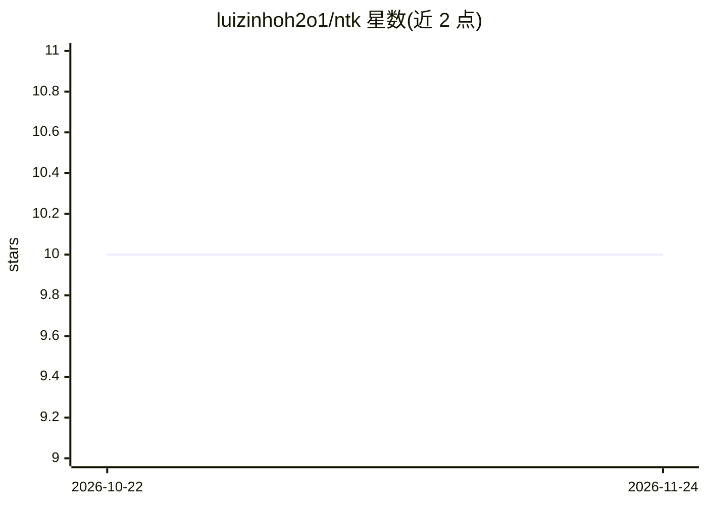

# luizinhoh2o1/ntk

⭐ 10 · Rust · MIT · 推送 2026-04-25 · [GitHub](https://github.com/luizinhoh2o1/ntk) · [官网](https://ntk.valraw.com) · 个人维护

**为 Claude Code 压缩工具输出的语义压缩代理**

以本地守护进程（127.0.0.1:8765）运行的 Rust 代理，通过 Claude Code 的 PostToolUse 钩子拦截 Bash 命令输出，经三层（另含可选 L1.5 规则层）压缩管线缩减 token，保留错误、警告与可执行信息；L1+L2 为确定性规则压缩，L3 在超过 token 阈值时触发本地神经推理（可选，支持 GPU）。守护进程不可达时回退原始输出。除 Claude Code 外，通过 MCP 集成 Cursor、Zed、Continue、OpenCode。提供 shell/PowerShell 安装器与源码构建两种安装方式。

## 筛选速览

| 维度 | 判定 | 备注 |
|---|---|---|
| AI 角色 | `ai-ecosystem` | LLM/agent 周边工具 |
| 许可风险 | `permissive` | MIT |
| 部署形态 | `desktop` | 安装包/桌面程序 |
| 模型依赖 | local-ok | 支持本地模型 |
| 硬件要求 | `cpu-ok` | |
| 安装摩擦 | `high` | 编译与系统依赖俱全 |
| 成熟度 | `idea` | |

## 能力要点

- 四层压缩管线，34 个确定性 fixture 语料平均压缩率 49.3%
- L3 本地神经推理可选，支持 Ollama/Candle/llama.cpp 后端与 GPU 加速，无云端依赖
- 通过 MCP 以 compress_output 工具接入 Cursor/Zed/Continue，无需守护进程
- 内置指标/历史/TUI 仪表盘，统计 token 节省量

## 适用场景

- 压缩 cargo test、tsc、git diff、Docker 日志等长输出以节省上下文
- 在 Cursor/Zed/Continue 等 agent 编辑器中按需压缩工具输出
- 在 CI 或脚本中以静态仪表盘查看 token 节省统计

## 场景标签

 · 领域:LLM 基础设施/上下文压缩

## 证据(README 行号)

> L5: **Semantic compression proxy for Claude Code — reduces tool output by 60–90 % before it reaches the model.**
> L33: NTK intercepts those outputs via the `PostToolUse` hook, compresses them semantically, and returns a compact versio
> L55: NTK runs as a local daemon (`127.0.0.1:8765`) and processes output through three layers:

## 星数曲线

2026-10-22 10 → 2026-11-24 10（+0）

---
*卡片 v1 · prompt 1.4 · 生成 2026-11-19 · 置信度 mid · 依据 README sha `3d0d6826924e` · [字段定义](../../DATASET.md)*
