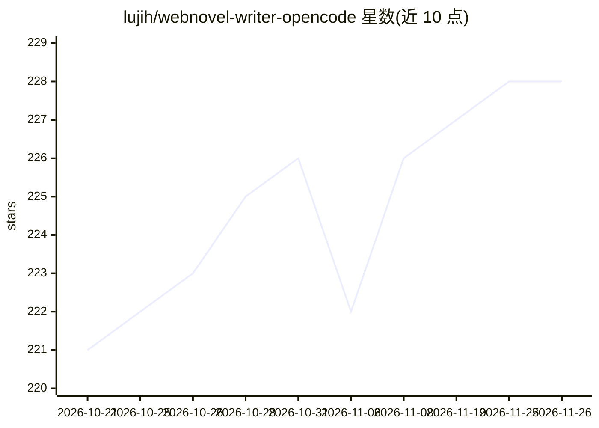

# lujih/webnovel-writer-opencode

⭐ 228 · Python · GPL-3.0 · 推送 2026-11-25 · [GitHub](https://github.com/lujih/webnovel-writer-opencode) · [官网](https://wnw.cszxorx.dpdns.org) · 个人维护 · 中文 README

**在 OpenCode 中进行长篇网文 AI 辅助创作的系统**

基于 OpenCode 框架的中文网文写作系统，源自 lingfengQAQ/webnovel-writer 的重构版本。针对连载中的「遗忘」「幻觉」「风格漂移」问题，提供分层 RAG 检索、故事合约引擎、SSOT 事件溯源、三层记忆系统、Graph-RAG 实体图谱与 6 维度审查管线；v3.0 新增一致性错误密度指标、叙事预报分支生成与门禁分层。通过 12 个斜杠命令覆盖从项目初始化、写章、审查到导出及发布番茄小说的全流程，需配合外部 Embedding API 使用。

## 筛选速览

| 维度 | 判定 | 备注 |
|---|---|---|
| AI 角色 | `ai-native` | 本体是模型或模型工具 |
| 许可风险 | `viral` | GPL-3.0 |
| 部署形态 | `library` | 以包/库形式分发 |
| 模型依赖 | — | README 未给出锁定关系 |
| 硬件要求 | — | 无带数字的原话,不猜 |
| 安装摩擦 | `low` | 无编译、无系统依赖或容器化 |
| 成熟度 | — | 结构信号不足 |

## 能力要点

- 三层 RAG 上下文与 SSOT 事件溯源，支持 200 万字量级连载
- 6 维度结构化审查管线与 Code Checker 硬约束阻断
- 12 个 OpenCode 斜杠命令覆盖写章/审查/导出/发布全流程
- Playwright 浏览器自动化发布番茄/七猫平台

## 适用场景

- 连载百万字级网文时保持设定与伏笔一致
- 批量写章后用审查命令做质量把关
- 写完后自动发布到番茄小说平台

## 场景标签

`AI 写作` `浏览器自动化` · 领域:效率与自动化

## 证据(README 行号)

> L52: Webnovel Writer for OpenCode 是一个面向长篇中文网文的 AI 辅助写作系统。它通过分层 RAG 检索、故事合约引擎和结构化质量审查，解决 AI 在连载创作中的"遗忘"和"幻觉"问题，支持从项目初始化到平
> L63: **系统要求**：Node.js ≥ 22、Python 3.10+、**OpenCode 2.x**（本项目已放弃 V1 兼容，V1 请用 v3.1.x 及更早版本）。
> L66: npx @cszx/webnovel-writer-opencode init

## 星数曲线

2026-10-21 221 → 2026-11-26 228（+7）

---
*卡片 v1 · prompt 1.4 · 生成 2026-11-26 · 置信度 high · 依据 README sha `e4dbcc463e0e` · [字段定义](../../DATASET.md)*
