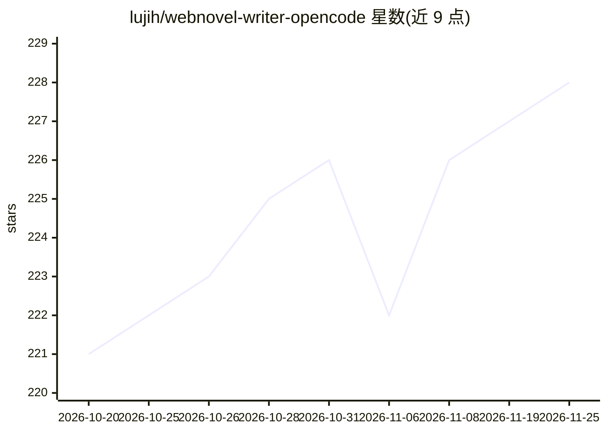

# lujih/webnovel-writer-opencode

⭐ 228 · Python · GPL-3.0 · 推送 2026-11-01 · [GitHub](https://github.com/lujih/webnovel-writer-opencode) · [官网](https://wnw.cszxorx.dpdns.org) · 个人维护

**网文作者的 OpenCode 长篇连载 AI 写作系统**

基于 OpenCode 框架的长篇中文网文 AI 辅助写作系统，改编自 lingfengQAQ/webnovel-writer。针对连载中的遗忘、幻觉、风格漂移问题，提供三层 RAG 上下文、Graph-RAG 实体图谱、故事合约引擎、SSOT 事件溯源、三层记忆系统与 6 维度审查管线；v3.0 加入一致性错误密度、叙事预报与门禁分层。通过 npm 安装到 OpenCode 工作区，以斜杠命令驱动从建书、写章到发布番茄小说的全流程。

## 筛选速览

| 维度 | 判定 | 备注 |
|---|---|---|
| AI 角色 | `ai-native` | 本体是模型或模型工具 |
| 许可风险 | `viral` | GPL-3.0 |
| 部署形态 | `library` | 以包/库形式分发 |
| 模型依赖 | — | README 未给出锁定关系 |
| 硬件要求 | — | 无带数字的原话,不猜 |
| 安装摩擦 | `low` | 无编译、无系统依赖或容器化 |
| 成熟度 | — | 结构信号不足 |

## 能力要点

- 三层 RAG 上下文 + Graph-RAG 实体图谱 + SSOT 事件溯源应对遗忘与幻觉
- 6 维度结构化审查管线，Code Checker 预处理加写-修循环
- 12 个斜杠命令覆盖初始化、大纲、单章/批量写作到番茄小说发布
- 只读诊断命令（wn-status/wn-doctor/wn-ssot-verify）核对数据一致性

## 适用场景

- 在 OpenCode 中连载 200 万字量级的长篇网文并保持设定一致
- 批量赶稿时自动审查章节质量并阻断一致性问题
- 写完直接通过 Playwright 自动化发布到番茄/七猫平台

## 场景标签

`AI 写作` `RAG` `浏览器自动化` · 领域:效率与自动化

## 证据(README 行号)

> L52: Webnovel Writer for OpenCode 是一个面向长篇中文网文的 AI 辅助写作系统。它通过分层 RAG 检索、故事合约引擎和结构化质量审查，解决 AI 在连载创作中的"遗忘"和"幻觉"问题，支持从项目初始化到平
> L106: 所有功能通过 OpenCode 的斜杠命令调用：
> L214: |**审查管线**|`review_pipeline.py`|Code Checker 预处理 → 6 维度结构化审查（写-修循环最多 2 轮）|

## 星数曲线

2026-10-20 221 → 2026-11-25 228（+7）

---
*卡片 v1 · prompt 1.4 · 生成 2026-11-25 · 置信度 high · 依据 README sha `7b42ed531953` · [字段定义](../../DATASET.md)*
