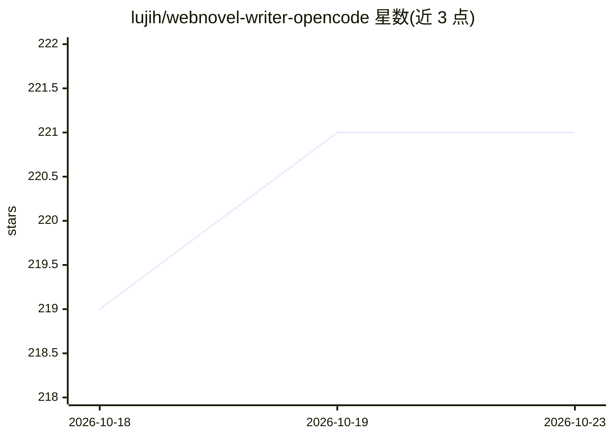

# lujih/webnovel-writer-opencode

⭐ 221 · Python · GPL-3.0 · 推送 2026-10-21 · [GitHub](https://github.com/lujih/webnovel-writer-opencode) · [官网](https://wnw.cszxorx.dpdns.org) · 个人维护 · 中文 README

**面向中文网文作者的 AI 长篇连载创作系统（OpenCode 插件）**

基于 OpenCode 框架的长篇网文 AI 辅助写作系统，从 lingfengQAQ/webnovel-writer 改编。通过三层 RAG 上下文、SSOT 事件溯源、Graph-RAG 实体图谱、故事合约引擎与 6 维度审查管线，应对连载中的遗忘、幻觉与风格漂移，宣称支持 200 万字量级。功能经斜杠命令调用，覆盖初始化、大纲、写作、审查、修复、导出及番茄小说发布（Playwright 自动化）。安装需 Node.js ≥ 22、Python 3.10+ 与 OpenCode 运行环境，用 npx 初始化。GPL v3 许可。

## 筛选速览

| 维度 | 判定 | 备注 |
|---|---|---|
| AI 角色 | `ai-native` | 本体是模型或模型工具 |
| 许可风险 | `viral` | GPL-3.0 |
| 部署形态 | `library` | 以包/库形式分发 |
| 模型依赖 | — | README 未给出锁定关系 |
| 硬件要求 | — | 无带数字的原话,不猜 |
| 安装摩擦 | `low` | 无编译、无系统依赖或容器化 |
| 成熟度 | — | 结构信号不足 |

## 能力要点

- 三层 RAG + SSOT 事件溯源 + Graph-RAG 实体图谱的上下文与记忆体系
- 6 维度结构化审查管线与门禁分层（review_flags 人工裁决）
- 叙事预报：写章前生成 2-5 个候选未来分支供选择
- 番茄/七猫发布适配器（Playwright 浏览器自动化）

## 适用场景

- 连载到数百章时保持设定、伏笔与角色一致性
- 批量写作与章节审查、重写、修复
- 将成稿直接发布到番茄小说等平台

## 场景标签

`AI 写作` · 领域:内容生成

## 证据(README 行号)

> L52: Webnovel Writer for OpenCode 是一个面向长篇中文网文的 AI 辅助写作系统。它通过分层 RAG 检索、故事合约引擎和结构化质量审查，解决 AI 在连载创作中的"遗忘"和"幻觉"问题，支持从项目初始化到平
> L119: |`/webnovel-publish`|发布番茄小说|平台上线|

## 星数曲线

2026-10-18 219 → 2026-10-23 221（+2）

---
*卡片 v1 · prompt 1.4 · 生成 2026-10-22 · 置信度 high · 依据 README sha `5d03aea6ede0` · [字段定义](../../DATASET.md)*
