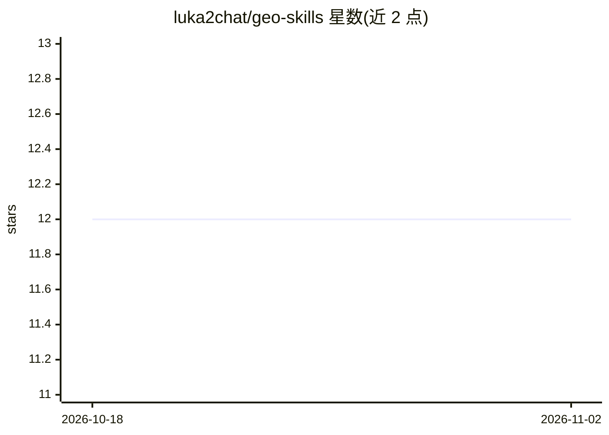

# luka2chat/geo-skills

⭐ 12 · MIT · 推送 2026-03-08 · [GitHub](https://github.com/luka2chat/geo-skills) · 个人维护

**给 AI 编码代理的 GEO（生成式引擎优化）最佳实践技能包**

面向 AI coding agent 的技能（skills）集合：提供 12 个规则文件，覆盖面向 AI 搜索引擎与 LLM 回答引擎的内容优化——内容策略、JSON-LD 结构化数据模板、robots.txt AI 爬虫配置、llms.txt 规范、E-E-A-T 与平台特定规则（ChatGPT/Perplexity 等）及监测方法。所有规则以可执行代码模板与清单形式给出，不含 SaaS 推荐。通过 npx skills add 安装，声明兼容 Cursor、Claude Code、Codex 等 37+ 代理。

## 筛选速览

| 维度 | 判定 | 备注 |
|---|---|---|
| AI 角色 | `ai-knowledge` | 知识聚合/清单类 |
| 许可风险 | `permissive` | MIT |
| 部署形态 | `library` | 以包/库形式分发 |
| 模型依赖 | — | README 未给出锁定关系 |
| 硬件要求 | — | 无带数字的原话,不猜 |
| 安装摩擦 | `low` | 无编译、无系统依赖或容器化 |
| 成熟度 | — | 结构信号不足 |

## 能力要点

- 12 个规则文件覆盖内容、技术实现、权威信任、平台分析四类
- 提供 JSON-LD 模板、robots.txt AI 爬虫配置、llms.txt 实现清单
- 以可执行代码模板与 checklist 形式交付，无 SaaS 列表
- 声明兼容 Cursor/Claude Code/Codex/Gemini CLI 等 37+ AI 代理

## 适用场景

- 让 AI 编码代理按 GEO 规范为网站添加结构化数据与爬虫配置
- 指导内容团队面向 AI 搜索引擎做可被引用的内容结构优化
- 配置并监测站点在 ChatGPT/Perplexity 等平台的引用情况

## 场景标签

`提示工程` · 领域:Agent 开发

## 证据(README 行号)

> L12: npx skills add luka2chat/geo-skills
> L31: 12 rule files covering the full GEO stack:

## 星数曲线

2026-10-18 12 → 2026-11-02 12（+0）

---
*卡片 v1 · prompt 1.4 · 生成 2026-11-01 · 置信度 high · 依据 README sha `981bbf435fc8` · [字段定义](../../DATASET.md)*
