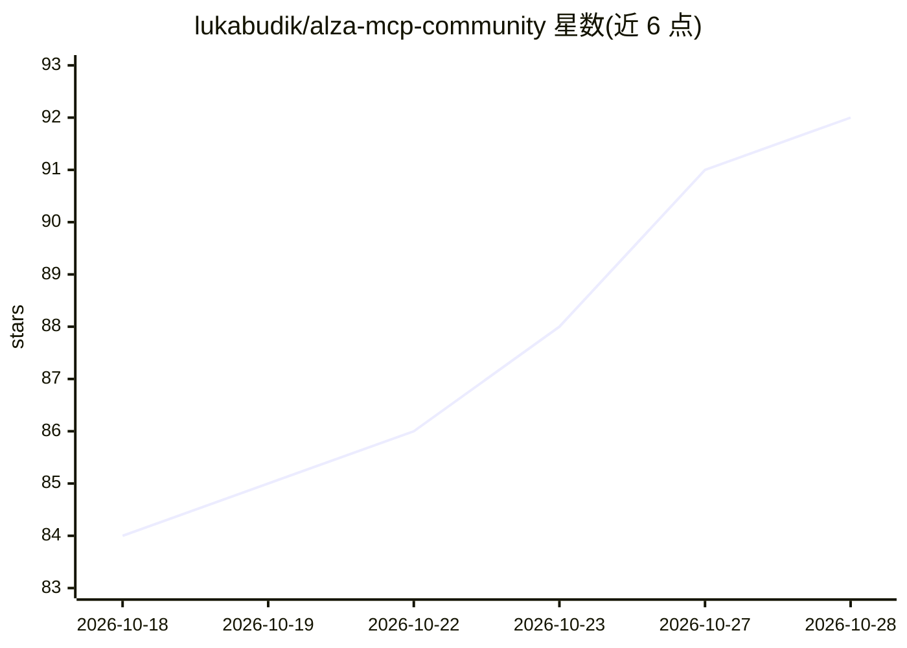

# lukabudik/alza-mcp-community

⭐ 93 · TypeScript · NOASSERTION · 推送 2026-10-28 · [GitHub](https://github.com/lukabudik/alza-mcp-community) · [官网](https://github.com/lukabudik/alza-mcp) · 个人维护

**让 AI agent 在 Alza.cz 购物下单的非官方 MCP 服务器**

社区维护的 Model Context Protocol 服务器，通过浏览器目录抓取与逆向的移动/Web API，让 Claude 等 MCP 客户端的 agent 在 Alza.cz 上搜索商品、读取详情与评论、管理购物车、选择配送/AlzaBox 自提并预览结账。提供 66 个工具，按 9 个工具集分组并采用渐进披露（默认仅启用 catalog 与 auth）。下单等写操作需一次性 mutation token（5 分钟过期）。通过 npx 安装，postinstall 下载 Playwright headless Chromium（约 92 MB）。项目自称非官方、仅供个人/研究用途。

## 筛选速览

| 维度 | 判定 | 备注 |
|---|---|---|
| AI 角色 | `ai-ecosystem` | LLM/agent 周边工具 |
| 许可风险 | `permissive` | NOASSERTION |
| 部署形态 | `desktop` | 安装包/桌面程序 |
| 模型依赖 | locked-api |  |
| 硬件要求 | — | 无带数字的原话,不猜 |
| 安装摩擦 | `low` | 无编译、无系统依赖或容器化 |
| 成熟度 | — | 结构信号不足 |

## 能力要点

- 66 个 MCP 工具按 9 个工具集分组，MCP 渐进披露按需启用
- 下单等变更操作需一次性确认 token，绑定操作与参数且 5 分钟过期
- PC 装机工具：兼容性检查与 CZK 预算内配置建议
- report_issue 工具生成脱敏问题草稿，由用户确认后才提交

## 适用场景

- 让 Claude 等 agent 在 Alza.cz 搜索并比较商品价格与库存
- 查询最近的 AlzaBox 自提点与营业时间
- 通过 agent 在预算内生成兼容的 PC 配置单

## 场景标签

`浏览器自动化` · 领域:效率与自动化

## 证据(README 行号)

> L14: `alza-mcp-community` is an unofficial **Model Context Protocol** server that gives Claude (or any MCP-aware agent) 
> L84: With 63 domain tools (66 including `list_toolsets`, `set_toolset` and `report_issue`), listing every tool on every 

## 星数曲线

2026-10-18 84 → 2026-10-28 92（+8）

---
*卡片 v1 · prompt 1.4 · 生成 2026-10-23 · 置信度 high · 依据 README sha `45d4c40b2a7c` · [字段定义](../../DATASET.md)*
