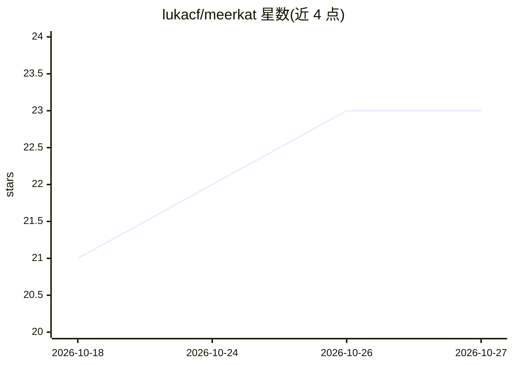

# lukacf/meerkat

⭐ 23 · Rust · Apache-2.0 · 推送 2026-10-26 · [GitHub](https://github.com/lukacf/meerkat) · 个人维护

**Rust 构建的模块化 agent 运行时平台，供开发与运行多智能体**

以 Rust crate 为核心的 library-first agent 运行时：提供 agent 执行循环、类型化事件、多 provider 接入（Anthropic/OpenAI/Gemini/Azure/自托管 OpenAI 兼容服务）、工具与 MCP、调度与持久化任务、多智能体 mob 及图像生成，通过 CLI、REST、JSON-RPC、MCP、Python/TypeScript/Web SDK 等多种 surface 复用同一套契约。面向需要嵌入或自建 agent 服务的开发者。安装途径含 Homebrew、cargo、pip、npm 与 GitHub 预编译二进制；自建编译需 Rust 1.94+。

## 筛选速览

| 维度 | 判定 | 备注 |
|---|---|---|
| AI 角色 | `ai-ecosystem` | LLM/agent 周边工具 |
| 许可风险 | `permissive` | Apache-2.0 |
| 部署形态 | `library` | 以包/库形式分发 |
| 模型依赖 | locked-api |  |
| 硬件要求 | — | 无带数字的原话,不猜 |
| 安装摩擦 | `medium` | 含编译或系统依赖之一 |
| 成熟度 | — | 结构信号不足 |

## 能力要点

- 统一 provider 运行时与模型目录，支持 Anthropic/OpenAI/Gemini/Azure 与自托管 OpenAI 兼容服务
- realm 作用域的会话、配置、认证绑定与持久化（内置 SQLite/JSONL）
- MCP、八类 hook、调度、WorkGraph、durable jobs 与多智能体 mob 编排
- CLI/REST/JSON-RPC/MCP/Python/TS/Web(WASM) 多 surface 共享同一运行时契约

## 适用场景

- 在自有应用中嵌入并驱动 agent 执行与工具调用
- 统一接入多家模型提供商与自托管 OpenAI 兼容服务
- 搭建多智能体团队与带持久化会话的 agent 服务

## 场景标签

`Agent 框架` `多智能体` · 领域:Agent 开发

## 证据(README 行号)

> L5:  A library-first Rust platform for building, hosting, and operating agents.
> L16: Meerkat provides a shared agent runtime, not a fixed agent user experience.
> L18: persistence, runtime control, and multi-agent orchestration. The CLI, REST,

## 星数曲线

2026-10-18 21 → 2026-10-27 23（+2）

---
*卡片 v1 · prompt 1.4 · 生成 2026-10-27 · 置信度 high · 依据 README sha `82e737cb7a2c` · [字段定义](../../DATASET.md)*
