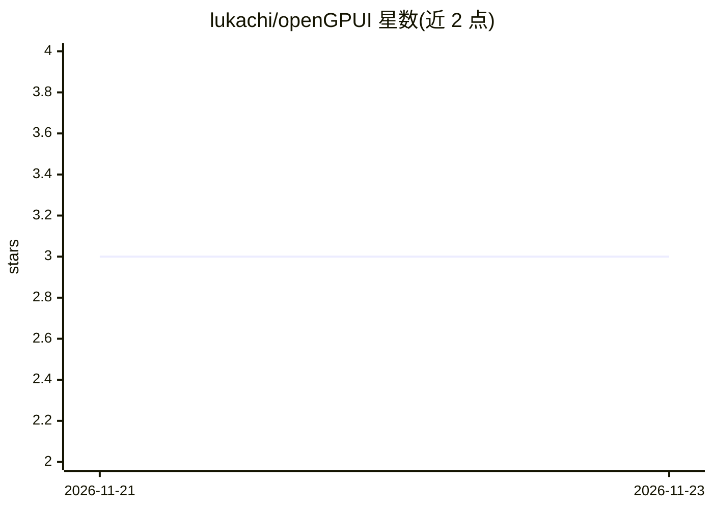

# lukachi/openGPUI

⭐ 3 · JavaScript · NOASSERTION · 推送 2026-11-07 · [GitHub](https://github.com/lukachi/openGPUI) · 个人维护

**给终端编码 Agent 渲染原生 UI 面板的 Herdr mod**

openGPUI 是 Herdr 终端里的一个原生 UI 渲染 mod：Agent 写一段 OpenUI Lang（.oui）文件，openGPUI 用 gpui-kit 在 Herdr 窗格中把它绘制成真实界面（表格、图表、表单、按钮、图示），用户的点击与表单值以 JSON 事件回传给 Agent，形成 human-in-the-loop 闭环。提供 CLI（prompt/check/show/wait/events/close）与一份教授 Agent 该语言的 SKILL.md，无需浏览器与 Web 服务器。依赖 Herdr 与 Node.js 18+/Bun，作者称已在 Codex 与 omp 上试过。

## 筛选速览

| 维度 | 判定 | 备注 |
|---|---|---|
| AI 角色 | `ai-ecosystem` | LLM/agent 周边工具 |
| 许可风险 | `none` | NOASSERTION |
| 部署形态 | `None` |  |
| 模型依赖 | — | README 未给出锁定关系 |
| 硬件要求 | — | 无带数字的原话,不猜 |
| 安装摩擦 | `low` | 无编译、无系统依赖或容器化 |
| 成熟度 | — | 结构信号不足 |

## 能力要点

- 移植 OpenUI 全部 86 个组件为原生 gpui-kit 元素
- Agent 写 .oui 文件即渲染 UI，按钮点击/表单值以 JSON 事件回传
- 支持架构图、流程图、状态机、时序图等自动布局图示与流式重绘
- 通过 CLI 与 SKILL.md 让任意能跑 shell 命令的 Agent 使用

## 适用场景

- 让编码 Agent 用图表和表单代替纯文本请求发布决策
- Agent 展示带数字的评审界面并等待用户确认
- 在终端环境中无需浏览器即可与 Agent 产出物交互

## 场景标签

`编码 Agent` · 领域:编码与开发

## 证据(README 行号)

> L3: Native UI for terminal coding agents. An agent writes a short OpenUI Lang
> L31: - **Works with any agent.** A small CLI (`prompt`, `check`, `show`, `wait`, `events`, `close`)
> L32:  and a skill teach the agent the language and the loop. It was tried with Codex and omp.

## 星数曲线

2026-11-21 3 → 2026-11-23 3（+0）

---
*卡片 v1 · prompt 1.4 · 生成 2026-11-21 · 置信度 high · 依据 README sha `6494f157d759` · [字段定义](../../DATASET.md)*
