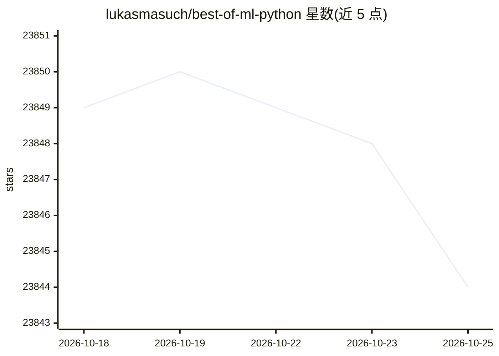

# lukasmasuch/best-of-ml-python

⭐ 23,846 · CC-BY-SA-4.0 · 推送 2026-10-22 · [GitHub](https://github.com/lukasmasuch/best-of-ml-python) · [官网](https://ml-python.best-of.org) · 个人维护

**给 ML 开发者的 Python 库排名清单，每周更新**

以自动化方式维护的机器学习 Python 开源项目目录：收录 920 个项目、划分为 34 个类别，按从 GitHub 与包管理器自动采集的指标计算项目质量分并排序。条目附星数、贡献者/下载/依赖数量、活跃状态、许可证警告等标记，并给出各库的 git clone、pip、conda、docker 安装命令。内容每周自动更新，社区可通过 issue、PR 或直接编辑 projects.yaml 参与维护。

## 筛选速览

| 维度 | 判定 | 备注 |
|---|---|---|
| AI 角色 | `ai-knowledge` | 知识聚合/清单类 |
| 许可风险 | `viral` | CC-BY-SA-4.0 |
| 部署形态 | `self-host` | docker 或自建部署 |
| 模型依赖 | — | README 未给出锁定关系 |
| 硬件要求 | — | 无带数字的原话,不猜 |
| 安装摩擦 | `low` | 无编译、无系统依赖或容器化 |
| 成熟度 | — | 结构信号不足 |

## 动量与使用信号

- 维护:`active` — 距上次 push 2.8 天,年发版 2,57 位贡献者
- 涨星:近 1 天 **+1**(自 20261016 起算)
- 安装:pypi 包 `tensorflow` 月下载 11,902,358
- 平台:— · 协议:MCP

## 能力要点

- 收录 920 个开源项目，分 34 个类别，基于质量分自动排序
- 指标自动采集自 GitHub 与多个包管理器，每周更新
- 条目标注关联生态（TensorFlow/PyTorch/JAX/Pandas 等）与活跃度、许可证警告
- 支持通过编辑 projects.yaml 直接贡献条目

## 适用场景

- 为机器学习任务选型 Python 库时浏览同类候选
- 按星数、下载量、维护活跃度等指标筛选开源项目
- 关注某个生态（如 JAX 或 PyTorch）相关的库列表

## 场景标签

`精选清单` · 领域:学习与行业

## 证据(README 行号)

> L3:  🏆&nbsp; A ranked list of awesome machine learning Python libraries. Updated weekly.
> L5: This curated list contains 920 awesome open-source projects with a total of 5.1M stars grouped into 34 categories. A

## 星数曲线

2026-10-18 23,849 → 2026-10-25 23,844（-5）

---
*卡片 v1 · prompt 1.4 · 生成 2026-10-18 · 置信度 mid · 依据 README sha `eee43dfcb9c0` · [字段定义](../../DATASET.md)*
