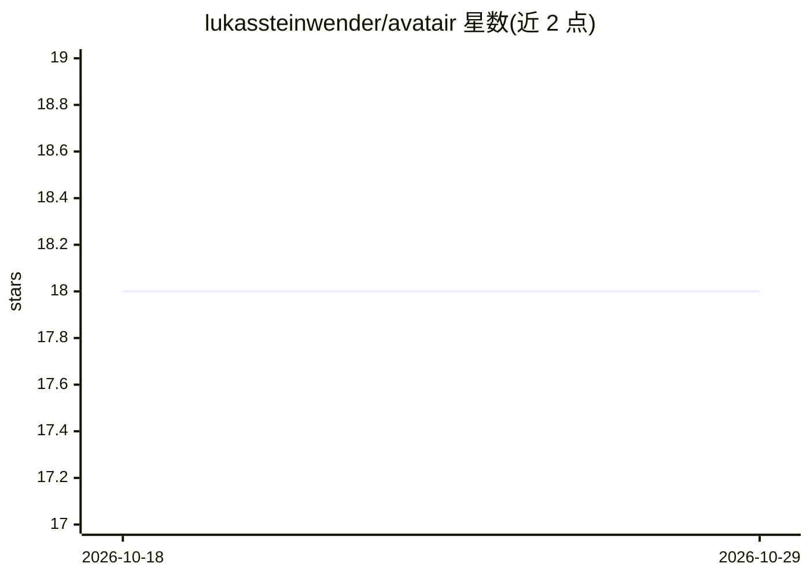

# lukassteinwender/avatair

⭐ 18 · Python · NOASSERTION · 推送 2026-06-12 · [GitHub](https://github.com/lukassteinwender/avatair) · 个人维护

**用 Stable Diffusion 与贝叶斯优化生成用户偏好写实头像的流水线**

科研用途的图像生成流水线：以 Stable Diffusion/SD XL 生成照片级写实头像，通过 BoTorch 贝叶斯优化根据用户对 acceptance、likeability、empathy 等量表或大五人格量表的评分迭代优化生成参数，输出用户偏好的头像。支持选择不同 SD 模型（默认 RealVisXL_V3.0）、定义变量或潜变量两种 prompt 生成模式、注意检查机制。以 Python 脚本形式提供，pip 安装依赖后运行 avatair.py；许可为 CC BY-NC-SA 4.0，仅限非商业使用。

## 筛选速览

| 维度 | 判定 | 备注 |
|---|---|---|
| AI 角色 | `ai-native` | 本体是模型或模型工具 |
| 许可风险 | `none` | NOASSERTION |
| 部署形态 | `library` | 以包/库形式分发 |
| 模型依赖 | — | README 未给出锁定关系 |
| 硬件要求 | — | 无带数字的原话,不猜 |
| 安装摩擦 | `low` | 无编译、无系统依赖或容器化 |
| 成熟度 | — | 结构信号不足 |

## 能力要点

- Stable Diffusion / SD XL 头像生成，可选 HuggingFace 模型
- 贝叶斯优化按用户量表评分迭代（接受度/大五人格等 3 组量表）
- defined 与 latent 两种 prompt 变量模式
- 支持插入 attention-check 机制

## 适用场景

- 做用户偏好头像生成的人机交互/心理学实验
- 按人格或接受度量表寻找目标人群偏好的头像设计
- 研究生成式头像的信任感与拟人度调优

## 场景标签

`图像生成` `科研工具` · 领域:内容生成

## 证据(README 行号)

> L39:  stablediffusion
> L40:  Choose between Stable Diffusion ("sd") and Stable Diffusion XL ("xl")
> L51:  promptmodel
> L55:  latent= e.g. acceptance, likeability, ...

## 星数曲线

2026-10-18 18 → 2026-10-29 18（+0）

---
*卡片 v1 · prompt 1.4 · 生成 2026-10-29 · 置信度 mid · 依据 README sha `efdd58bbb55a` · [字段定义](../../DATASET.md)*
