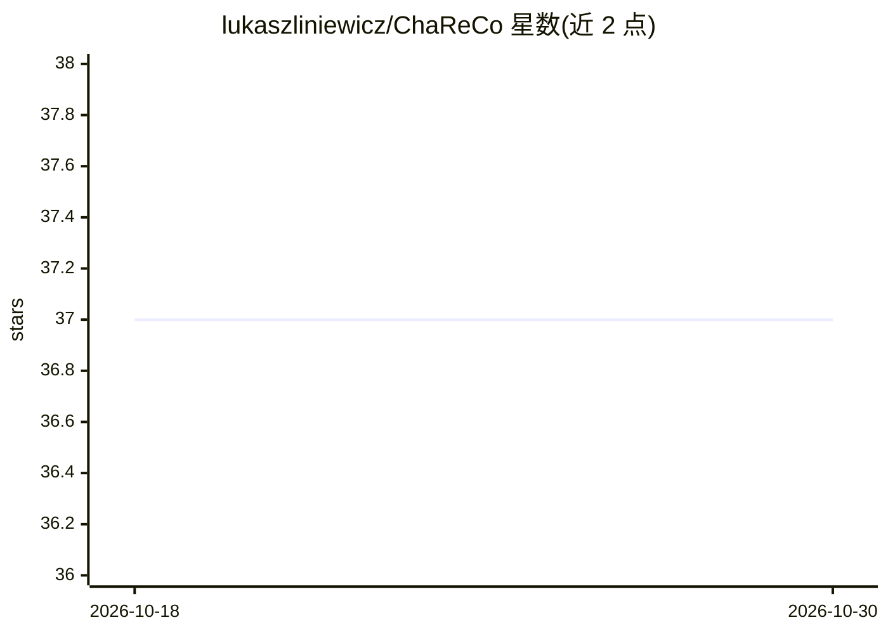

# lukaszliniewicz/ChaReCo

⭐ 37 · Python · MIT · 推送 2026-07-13 · [GitHub](https://github.com/lukaszliniewicz/ChaReCo) · 个人维护

**将仓库/本地文件夹拼为纯文本以供粘贴给 LLM 聊天的工具**

提供 GUI（chareco）与无头 CLI（chareco-context）两种形式：浅克隆远程 Git 仓库（私有仓库可用 PAT）或读取本地文件夹，按扩展名与 glob 模式过滤，剪枝忽略目录、跳过符号链接/二进制/疑似密钥文件，生成确定性目录树与拼接文本文件内容供手动粘贴进 LLM 聊天界面。支持异步正则搜索、保留相对路径与行号的复制、本地文件夹刷新保留选择、notebook 转 Markdown，并限制单文件与总输出大小（默认 1 MiB/20 MiB）。明确不提供与 LLM 的直接集成，token 计数（cl100k_base）仅为估算。

## 筛选速览

| 维度 | 判定 | 备注 |
|---|---|---|
| AI 角色 | `ai-ecosystem` | LLM/agent 周边工具 |
| 许可风险 | `permissive` | MIT |
| 部署形态 | `desktop` | 安装包/桌面程序 |
| 模型依赖 | — | README 未给出锁定关系 |
| 硬件要求 | — | 无带数字的原话,不猜 |
| 安装摩擦 | `low` | 无编译、无系统依赖或容器化 |
| 成熟度 | — | 结构信号不足 |

## 能力要点

- 浅克隆仓库并记录来源、修订与限制的清单
- 扩展名与 glob 过滤，默认跳过二进制、符号链接与疑似密钥文件
- 异步正则搜索并在文件树中高亮命中文件
- 复制保留相对路径与行号，notebook 自动转 Markdown

## 适用场景

- 为 LLM 聊天准备代码库上下文做重构、调试或代码审查
- 大型项目中检索特定函数/配置的分布位置
- 配合 CLI 编码助手，向更强模型的聊天界面提供最新代码上下文

## 场景标签

 · 领域:开发者工具/LLM 上下文

## 证据(README 行号)

> L3: A GUI and command-line tool for creating bounded, searchable context from local folders and Git repositories. It pro
> L8: >- This tool does not provide direct integration with LLMs.
> L9: >- It's meant to support manual copying and pasting into chat interfaces.

## 星数曲线

2026-10-18 37 → 2026-10-30 37（+0）

---
*卡片 v1 · prompt 1.4 · 生成 2026-10-25 · 置信度 high · 依据 README sha `75ac33673fbf` · [字段定义](../../DATASET.md)*
