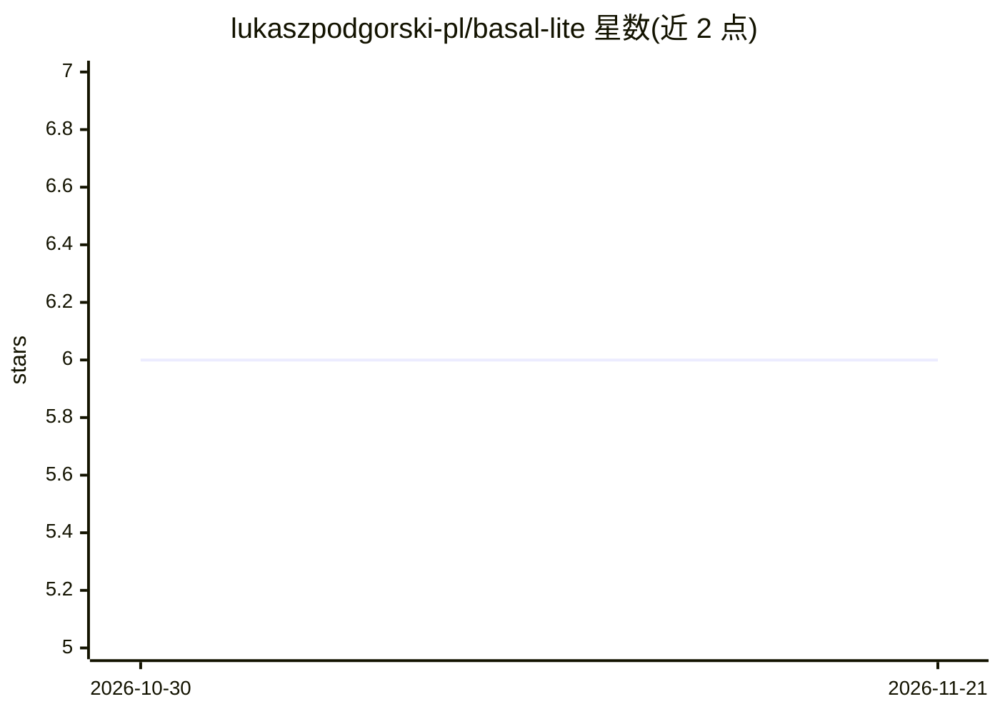

# lukaszpodgorski-pl/basal-lite

⭐ 6 · Python · Apache-2.0 · 推送 2026-11-01 · [GitHub](https://github.com/lukaszpodgorski-pl/basal-lite) · 个人维护

**轻量 Python 客户端：在标准 vLLM 服务器上复现 basal 决策逻辑**

basal-lite 将 basal-serve 围绕模型的逻辑（prompt 格式、选项排序、校准、各题型、媒体与 think 模式）移入约 800 行的 Python 客户端，服务器端保持原版 `vllm serve` 与标准 OpenAI API，不含 basal 代码。工作方式：对每个问题构造 basal prompt、经 /tokenize 定位选项码 token、请求一个带 allowed_token_ids 与 logprobs 的生成，再做 softmax、多序平均与温度校准。通过 Docker 启动 vLLM，需 NVIDIA GPU 与 Python 3.10+；不支持依赖隐藏状态的 evidence 与 early_exit。

## 筛选速览

| 维度 | 判定 | 备注 |
|---|---|---|
| AI 角色 | `ai-ecosystem` | LLM/agent 周边工具 |
| 许可风险 | `permissive` | Apache-2.0 |
| 部署形态 | `self-host` | docker 或自建部署 |
| 模型依赖 | local-ok | 支持本地模型 |
| 硬件要求 | — | 无带数字的原话,不猜 |
| 安装摩擦 | `low` | 无编译、无系统依赖或容器化 |
| 成熟度 | — | 结构信号不足 |

## 能力要点

- 客户端承担 prompt 构造、选项排序、softmax 读出与温度校准，服务器保持原版 vLLM
- 支持 choice/noul/score/multi/act/tool 题型及 classify/verify/compress/extract 任务
- 支持图像与音频输入及 think 模式（独立 think 权重服务器）
- 提供 tools/compare.py 等脚本用于更新后的一致性检查

## 适用场景

- 在已有的 vLLM 部署上运行 basal 决策模型而不更换推理服务
- 让同一 vLLM 服务器同时服务 basal 与其他应用
- 自行管理 vLLM 升级，用 check_prompt.py 验证 prompt 一致性

## 场景标签

 · 领域:LLM 基础设施/推理客户端

## 证据(README 行号)

> L3: **basal decisions from a stock vLLM server.** basal-lite is a small Python client that does everything
> L46: basal-lite moves that logic into a client of about 800 lines (plus basal's own pure modules, vendored) and leaves t
> L136: Requirements: an NVIDIA GPU, Docker with GPU support, Python 3.10+. The server image `vllm/vllm-openai:v0.32.0` an

## 星数曲线

2026-10-30 6 → 2026-11-21 6（+0）

---
*卡片 v1 · prompt 1.4 · 生成 2026-11-20 · 置信度 mid · 依据 README sha `2f0da44e3375` · [字段定义](../../DATASET.md)*
