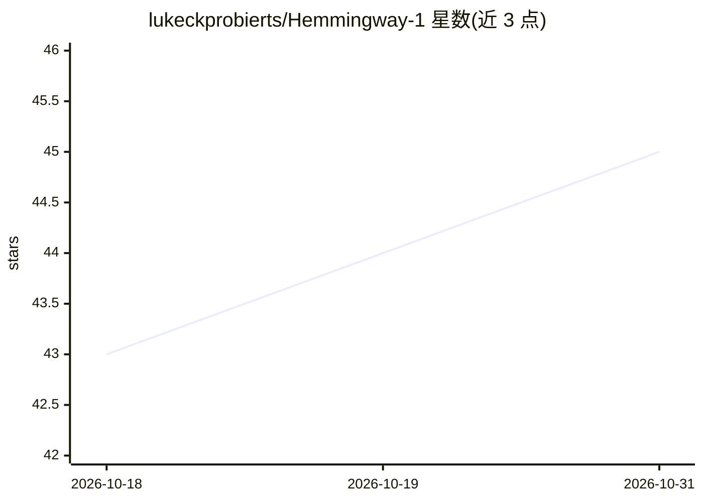

# lukeckprobierts/Hemmingway-1

⭐ 45 · NOASSERTION · 推送 2026-10-01 · [GitHub](https://github.com/lukeckprobierts/Hemmingway-1) · [官网](https://hemmingway.io) · 组织维护

**27B 开放权重写作模型：以贴近人类口吻生成日常文本**

基于 Qwen3.8-27B 的 27B 参数语言模型，权重开放，面向日常写作场景（消息、邮件、同事便条等），主打直接给出文本而非多选项加解释，并以类人语感为设计目标。支持 262,144 token 上下文，提供 vllm serve 启动命令与 transformers 加载示例，另有 Mac/Android 应用入口。许可为 CC BY-NC 4.0：非商业用途免费，商业用途需另行协商。README 声明其多数基准为自建（CommunicationBench/Human-Likeness/StoryBench），并注明英语优先、不适用于医疗法律财务决策。

## 筛选速览

| 维度 | 判定 | 备注 |
|---|---|---|
| AI 角色 | `ai-native` | 本体是模型或模型工具 |
| 许可风险 | `none` | NOASSERTION |
| 部署形态 | `None` |  |
| 模型依赖 | local-ok | 支持本地模型 |
| 硬件要求 | — | 无带数字的原话,不猜 |
| 安装摩擦 | `low` | 无编译、无系统依赖或容器化 |
| 成熟度 | — | 结构信号不足 |

## 能力要点

- 27B 参数，基于 Qwen3.8-27B，上下文 262,144 tokens
- 开放权重，CC BY-NC 4.0 非商业免费，商业需协商
- 提供 vllm serve 与 transformers 两种运行方式
- Mac 和 Android 应用入口

## 适用场景

- 生成日常消息、邮件等直接可用的文本
- 本地部署一个写作向语言模型
- 长上下文的写作与对话任务

## 场景标签

`AI 写作` · 领域:内容生成

## 证据(README 行号)

> L3: **The AI that writes like a person.** 27B parameters, open weights, free for non-commercial use.
> L92: |Built on|Qwen3.8-27B|

## 星数曲线

2026-10-18 43 → 2026-10-31 45（+2）

---
*卡片 v1 · prompt 1.4 · 生成 2026-10-25 · 置信度 high · 依据 README sha `59b2c0ac8c68` · [字段定义](../../DATASET.md)*
