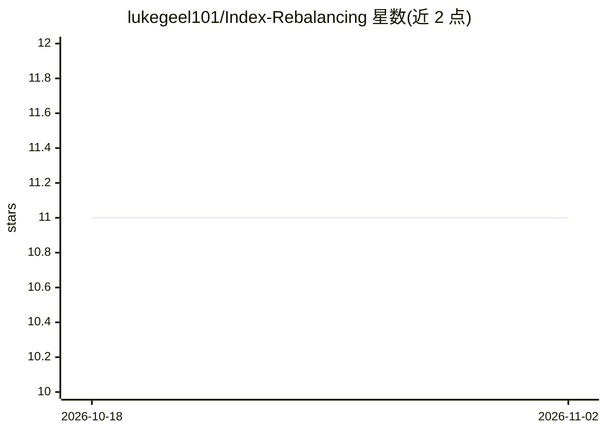

# lukegeel101/Index-Rebalancing

⭐ 11 · Jupyter Notebook · MIT · 推送 2026-08-31 · [GitHub](https://github.com/lukegeel101/Index-Rebalancing) · 组织维护

**UMass 团队用线性回归与 LSTM 研究标普指数调仓的股价效应**

UMass Amherst 的探索性量化金融研究项目：研究股票被纳入 S&P 指数后 24 小时价格效应，用线性回归与 LSTM 两类模型基于公司、行业、指数、成交量、股息、市值特征做预测。数据来自 Yahoo Finance 与 S&P 官方 PDF 调仓清单，经 Tabula 解析；因历史 API 覆盖与缺失数据，可用数据集仅 92 条观测。支持的评估路径为对已提交 CSV 做指纹校验与描述性统计复算，历史 notebook 不再重训；README 声明非投资建议。

## 筛选速览

| 维度 | 判定 | 备注 |
|---|---|---|
| AI 角色 | `ai-native` | 本体是模型或模型工具 |
| 许可风险 | `permissive` | MIT |
| 部署形态 | `None` |  |
| 模型依赖 | — | README 未给出锁定关系 |
| 硬件要求 | — | 无带数字的原话,不猜 |
| 安装摩擦 | `low` | 无编译、无系统依赖或容器化 |
| 成熟度 | `idea` | |

## 能力要点

- 比较可解释线性回归与 LSTM 对指数纳入后价格变化的预测
- 数据集覆盖 2021-05 至 2022-12 的 92 条 S&P 纳入观测（91 只股票、3 个指数、11 个 GICS 行业）
- 提供 evaluate_dataset.py 校验脚本与单元测试复现已提交的评估结果

## 适用场景

- 复现并校验指数调仓研究的已提交评估结果
- 了解线性回归与 LSTM 在小样本金融预测中的方法论
- 作为指数纳入价格效应的探索性研究参考

## 场景标签

`金融量化` · 领域:学习与行业

## 证据(README 行号)

> L9: Can machine learning identify which stocks will move after they are added to an S&P index?
> L10: This UMass Amherst research project combines market data, linear regression, and LSTM models to study the 24-hour p
> L50: The input to our model consists of stocks being added or removed from the index, along with performance variables s

## 星数曲线

2026-10-18 11 → 2026-11-02 11（+0）

---
*卡片 v1 · prompt 1.4 · 生成 2026-11-02 · 置信度 high · 依据 README sha `0f2b434de689` · [字段定义](../../DATASET.md)*
