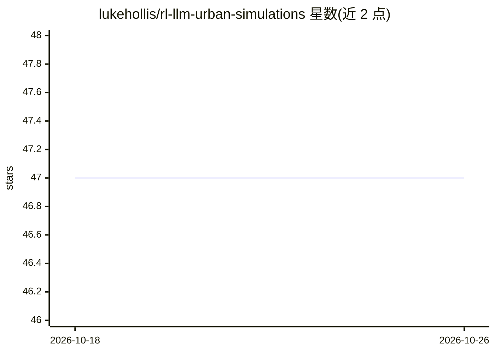

# lukehollis/rl-llm-urban-simulations

⭐ 47 · C# · 推送 2026-04-15 · [GitHub](https://github.com/lukehollis/rl-llm-urban-simulations) · 个人维护

**RL+LLM 混合驱动的城市级游戏引擎多智能体仿真系统**

在 Unity 游戏引擎环境中构建城市级 NPC 仿真：个体角色由强化学习策略在引擎内做推理驱动行为，语言模型负责对策略推断出的动作进行理性反思与规划，并可在游戏内可视化角色内部状态。系统包含 Python/Django 后端经 websocket 与 Unity 互联的网络化状态管理、三级优先级记忆系统、对话/社交动态（The Feed）与世界状态持久化。面向城市交通与出行规划等仿真场景，曾为 BART 列车系统做数字孪生。作者声明已停止 Unity 开发（因费用过高），代码可供继续使用。需 Python 3.10+、Unity ML-Agents、PyTorch、OpenAI Gym，pip 安装依赖后在 Unity 中配置组件使用。

## 筛选速览

| 维度 | 判定 | 备注 |
|---|---|---|
| AI 角色 | `ai-native` | 本体是模型或模型工具 |
| 许可风险 | `none` | — |
| 部署形态 | `library` | 以包/库形式分发 |
| 模型依赖 | — | README 未给出锁定关系 |
| 硬件要求 | — | 无带数字的原话,不猜 |
| 安装摩擦 | `low` | 无编译、无系统依赖或容器化 |
| 成熟度 | — | 结构信号不足 |

## 能力要点

- RL 策略推理 + LLM 反思的混合 NPC 行为架构（受 CoALA 启发）
- Unity 与 Python/Django 后端 websocket 互联的网络化状态管理
- 三级优先级分层记忆系统（LLM 对记忆排序）
- 对话系统与类社交网络的 The Feed 公共发布机制

## 适用场景

- 在城市环境中构建具有拟人行为的多智能体仿真
- 交通与出行规划场景的数字孪生模拟
- 研究 RL+LLM 混合驱动的 NPC 记忆与社交行为

## 场景标签

`多智能体` · 领域:Agent 开发

## 证据(README 行号)

> L9: Individual characters can be controlled by RL policy, running inference in engine, and interpret and plan actions wi
> L13: Inspired by the CoALA Cognitive Architectures for Language Agents, the NPCs in the simulations build on a similar v

## 星数曲线

2026-10-18 47 → 2026-10-26 47（+0）

---
*卡片 v1 · prompt 1.4 · 生成 2026-10-25 · 置信度 high · 依据 README sha `307ccfc91d97` · [字段定义](../../DATASET.md)*
