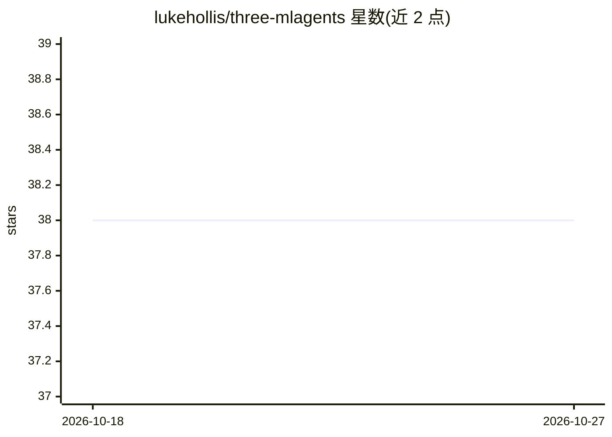

# lukehollis/three-mlagents

⭐ 38 · Python · 推送 2026-07-06 · [GitHub](https://github.com/lukehollis/three-mlagents) · [官网](https://lukehollis.github.io/three-mlagents/) · 个人维护

**浏览器可视化 + Python 训练的 Unity ML-Agents 重新实现**

用 JavaScript（React + Three.js）与 Python（FastAPI）重新实现 Unity ML-Agents 核心示例：后端提供 Gymnasium 任务注册表、Stable-Baselines3 训练/评估助手、CLI 与 SB3 策略产物；浏览器端用于检查环境并与后端 WebSocket 交互，纯浏览器操作时无需后端。包含 3DBall、GridWorld、Ant 等 10 余个示例环境，其中 MineCraft 示例结合 RL 与 LLM（本地 Ollama 或 OpenRouter 云端）实现策略决策、交流与交易。面向强化学习研究者与学习者。

## 筛选速览

| 维度 | 判定 | 备注 |
|---|---|---|
| AI 角色 | `ai-native` | 本体是模型或模型工具 |
| 许可风险 | `none` | — |
| 部署形态 | `library` | 以包/库形式分发 |
| 模型依赖 | local-ok | 支持本地模型 |
| 硬件要求 | — | 无带数字的原话,不猜 |
| 安装摩擦 | `low` | 无编译、无系统依赖或容器化 |
| 成熟度 | — | 结构信号不足 |

## 能力要点

- Gymnasium 任务注册表与 Stable-Baselines3 训练/评估 CLI，策略保存为 SB3 .zip
- React + Three.js 浏览器端环境可视化与交互，纯浏览器模式无需后端
- 10 余个复刻 Unity ML-Agents 的示例环境（3DBall/GridWorld/Ant 等）
- MineCraft 示例结合 RL 与 LLM，支持本地 Ollama 或 OpenRouter

## 适用场景

- 在浏览器中交互式学习 Unity ML-Agents 的强化学习思想
- 用 SB3 在复刻环境上做可复现的 RL 训练与评估
- 研究 RL 与 LLM 结合的智能体行为（MineCraft 示例）

## 场景标签

`强化学习` · 领域:训练与推理

## 证据(README 行号)

> L13: A **JavaScript / Python** re-implementation of the core Unity ML-Agents examples. Test out the Live Demos.
> L80: * **Python training/eval**: `backend/mlagents` provides a Gymnasium task registry, Stable-Baselines3 training/evalu
> L91: uv run three-mlagents train basic --algorithm dqn --timesteps 25000 --seed 1

## 星数曲线

2026-10-18 38 → 2026-10-27 38（+0）

---
*卡片 v1 · prompt 1.4 · 生成 2026-10-25 · 置信度 high · 依据 README sha `4c425c4015fd` · [字段定义](../../DATASET.md)*
