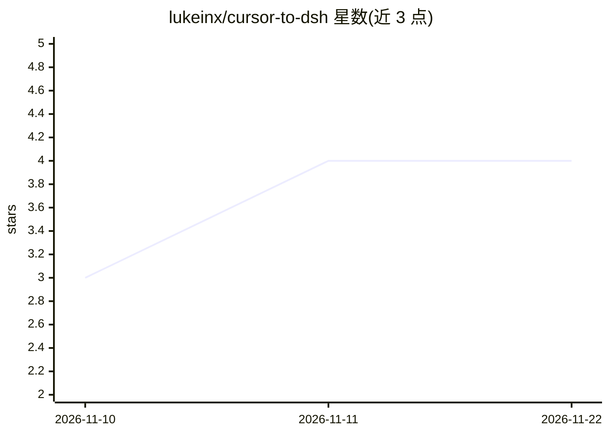

# lukeinx/cursor-to-dsh

⭐ 4 · TypeScript · MIT · 推送 2026-11-14 · [GitHub](https://github.com/lukeinx/cursor-to-dsh) · [官网](https://www.npmjs.com/package/cursor-to-dsh) · 个人维护 · 中文 README

**把 Cursor 模型注册为 DSH 模型提供方的插件**

一个 DeepSeek Harness（DSH）插件，通过官方 @cursor/sdk 和用户自己的 Cursor API Key，把 Cursor 模型注册为 DSH 的 `cursor` LLM 提供方。DSH 保留 agent 循环、工具与权限沙箱，Cursor 仅作为模型；每个 DSH 会话对应一个 Cursor agent，工具结果回填到同一 run，支持模型目录实时获取与用量桶上报。安装走 Desktop 插件页或 `dsh plugin` CLI，文档为中文。

## 筛选速览

| 维度 | 判定 | 备注 |
|---|---|---|
| AI 角色 | `ai-ecosystem` | LLM/agent 周边工具 |
| 许可风险 | `permissive` | MIT |
| 部署形态 | `library` | 以包/库形式分发 |
| 模型依赖 | — | README 未给出锁定关系 |
| 硬件要求 | — | 无带数字的原话,不猜 |
| 安装摩擦 | `low` | 无编译、无系统依赖或容器化 |
| 成熟度 | — | 结构信号不足 |

## 能力要点

- 通过官方 @cursor/sdk 接入，不逆向私有协议
- 工具归 DSH 执行，沿用其沙箱与审批机制
- 每会话一个 Cursor agent，只发新增内容并复用缓存
- 密钥经 DSH 凭据服务写入本机（0600 权限，热加载）

## 适用场景

- 在 DSH/DeepSeek Desktop 中使用 Cursor 模型驱动 agent 会话
- 保留 DSH 工具沙箱的同时切换模型提供方
- 无 Web 界面的 CLI/CI profile 通过环境变量或凭据文件提供密钥

## 场景标签

`编码 Agent` `模型网关` · 领域:Agent 开发

## 证据(README 行号)

> L6: > Use Cursor models as the `cursor` LLM provider in DeepSeek Harness (DSH) and DeepSeek Desktop, through the officia
> L14: - **官方接口**：只用 Cursor 官方 `@cursor/sdk` 和你自己的 API Key，不逆向私有协议、不读 Cursor IDE 登录态；通过 DSH 的 `ctx.llm.registerAdapter` 注册

## 星数曲线

2026-11-10 3 → 2026-11-22 4（+1）

---
*卡片 v1 · prompt 1.4 · 生成 2026-11-21 · 置信度 high · 依据 README sha `f4818a8caea0` · [字段定义](../../DATASET.md)*
